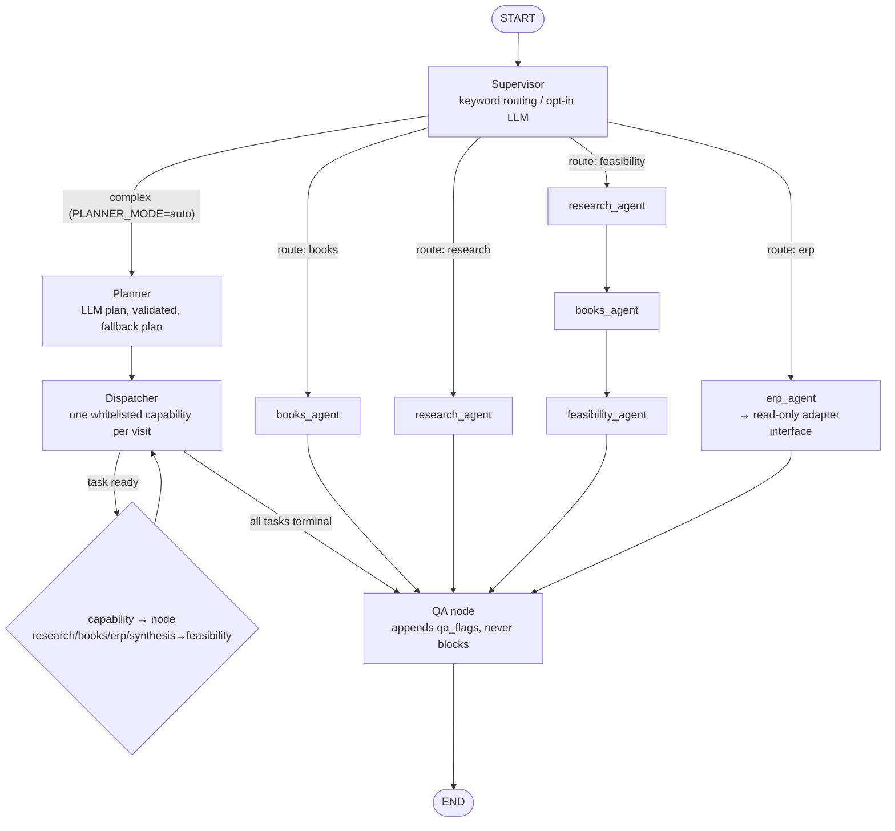
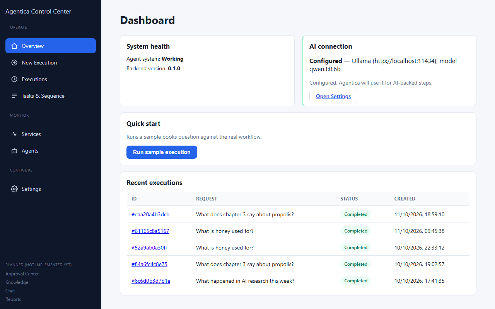
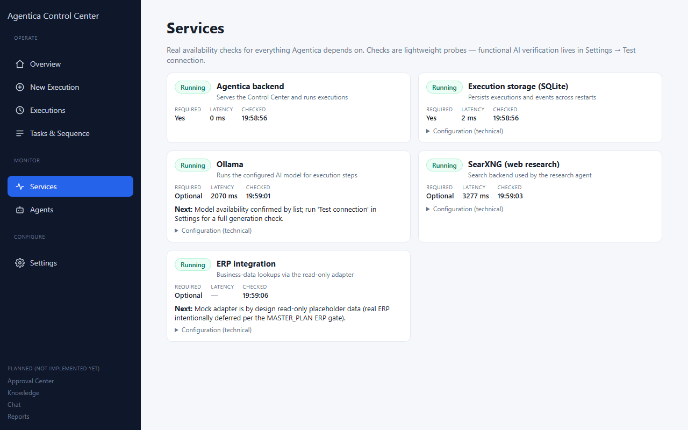
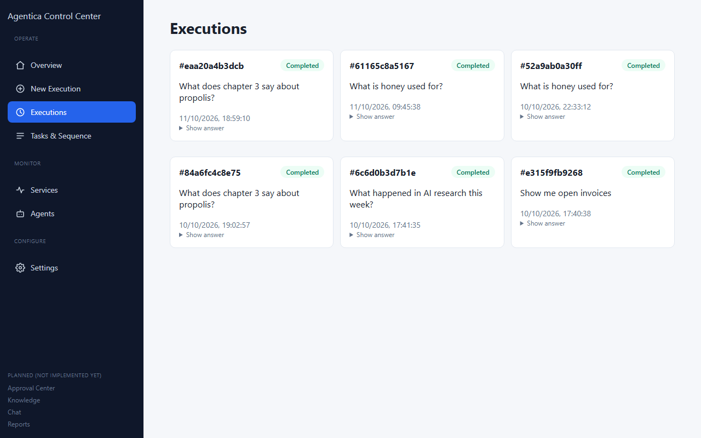

# Agentica

Agentica is a local-first, multi-agent assistant for business questions. You
type a question in plain language — "What does our manual say about X?",
"What happened in this market?", "Do a feasibility study for Y", "Show me
open invoices" — and a recorded LangGraph pipeline routes it to the right
specialist agent and answers with provenance, quality flags, and an honest
refusal when the evidence is not there.

**Agentica is not finished software.** It is a working development preview:
the agent core (Phases 1–8, including plan execution) and a local web
dashboard (the Control Center) are implemented and tested; larger planned
parts (approval workflows, knowledge management, chat, reports UI,
authentication, real ERP integration) are not started — see
[Roadmap](#9-implemented-vs-planned-roadmap). Everything below describes what
actually works in this checkout.

Deep-dive documentation lives in [`docs/`](docs/): architecture
([docs/ARCHITECTURE.md](docs/ARCHITECTURE.md)), status
([docs/PROJECT_STATUS.md](docs/PROJECT_STATUS.md)), roadmap
([docs/MASTER_PLAN.md](docs/MASTER_PLAN.md)), dashboard plan
([docs/CONTROL_CENTER_PLAN.md](docs/CONTROL_CENTER_PLAN.md)), and testing
([docs/TESTING.md](docs/TESTING.md)). This README does not duplicate them;
it gives an accurate overview plus working setup commands.

## 1. Project overview

**The problem.** Businesses hold knowledge in three disconnected places:
internal documents (manuals, books, policies), the live web, and business
systems (ERP records). Asking a question that spans them today means opening
each tool separately and trusting whatever it returns. Agentica is an
experiment in one honest interface: a question is routed to the right
specialist, every answer carries its sources, and the system says "not found"
rather than inventing content.

**What it does today.**
* Answers questions from an ingested document library (PDF/DOCX → Chroma
  vector store) with file/page citations and a deterministic grounding gate.
* Performs web research (SearXNG search → Crawl4AI extraction → LLM
  synthesis) with source URLs.
* Produces feasibility studies (Market/Financial/Risk) saved as `.docx`,
  degrading honestly to a flagged "web-only" study when the library has
  nothing relevant.
* Looks up business data through a **read-only** ERP adapter (today: a
  deterministic mock with fictional records only).
* Decomposes complex requests into a validated task plan and **executes**
  that plan through a capability whitelist (Phases 7–8), recording honest
  per-task statuses.
* Records every step in a local SQLite event log and exposes it all through
  a local web dashboard ("Control Center").

**Scope and limitations (current).**
* Single-user, localhost-only. **The API has no authentication** — anything
  that can reach `127.0.0.1:8000` can read every execution.
* The ERP integration is a mock; no real ERP vendor has been selected.
* The document corpus is small (a couple of sample documents by default);
  anything outside it is refused by design.
* The LLM is either a local Ollama model or Google Gemini (default provider
  setting is `gemini`; no key = AI-backed steps fail with a structured
  error). Keyword routing and most test suites never need a live model.
* One execution runs at a time, synchronously, inside the API request —
  there is no queue, no worker pool, and no pause/cancel.

## 2. Architecture

Two processes, one state contract:

* **Frontend** — React + TypeScript + Vite (`frontend/`), hash-routed SPA
  with no router dependency. Dev server on **http://localhost:3333**
  (`strictPort`), proxying `/api` to the backend on `127.0.0.1:8000`
  (`frontend/vite.config.ts`).
* **Backend** — FastAPI (`app/api/server.py`), bound to `127.0.0.1:8000`.
  `POST /api/v1/executions` creates **and runs** an execution synchronously
  through `GraphRunner` (`app/execution/runner.py`), persisting every step
  via `ExecutionStore` (`app/execution/store.py`) into
  `storage/control_center.sqlite3`.
* **Graph** — one compiled LangGraph `StateGraph` over a single
  `AgentState` TypedDict (`app/state.py`, `app/graph.py`). Nodes return only
  the keys they change; agents never call agents — all data flows through
  state.



Conditional paths, labeled honestly:

* The **planner hop** only happens for requests the supervisor marks
  `complex` (`PLANNER_MODE=auto`, default) — simple and multi requests take
  the same edges they took before Phase 7 existed.
* The **dispatcher** only exists for planned (complex) requests. It maps
  capabilities to nodes through the literal `CAPABILITY_NODES` table in
  `app/graph.py` — plan data can never name a node or call a function.
* The **feasibility chain** (research → books → feasibility) is wired with
  conditional edges that hand off only while `route == "feasibility"`.

Supporting infrastructure: single LLM factory (`app/llm_client.py` — Gemini
or Ollama via `LLM_PROVIDER`; agents never instantiate models), central
config (`app/config.py` — the only place models/paths/ports live), bounded
service probes (`app/services_health.py`), AI settings with masking
(`app/ai_settings.py`, `app/ai_diagnostics.py`), and a fail-closed Chroma
guard for tests (`app/chroma_guard.py`). Full diagrams and the component
table: [docs/ARCHITECTURE.md](docs/ARCHITECTURE.md).

## 3. How an execution works, step by step

One normal request, as the code actually runs it (all steps recorded as
events in SQLite):

1. **Submit** — from the dashboard (`Run sample execution`, New Execution)
   or `POST /api/v1/executions`. The question is validated at the API
   boundary: 3–2,000 characters (`app/api/server.py`). A row is created
   with `status=queued` and an `execution.created` event.
2. **Start** — the runner marks it `running` and invokes the compiled graph
   with the question. (The HTTP call blocks until the run finishes; there is
   no queue.)
3. **Routing** — the supervisor decides `route` (`app/supervisor.py`):
   deterministic keyword rules by default (`feasibility → erp → books →
   research` fallback order). With `ROUTING_MODE=llm` (opt-in), an LLM
   classifier is consulted first and **any** failure falls back to keywords.
   A `routing.decided` event records the outcome.
4. **Planning (conditional)** — if the supervisor marks the request
   `complex` and `PLANNER_MODE=auto`, the planner node
   (`app/planner.py`) asks the LLM for a small ordered task plan and
   validates it deterministically: capabilities must be inside the code
   whitelist (`research|books|erp|synthesis`), task ids unique and
   well-formed, dependencies existing and acyclic, required inputs
   satisfiable, ≤ `MAX_PLAN_TASKS` (6) tasks. Any failure — LLM down,
   malformed JSON, invalid plan — falls back to a deterministic
   route-derived default plan with recorded `fallback_reasons`; the request
   is still answered.
5. **Execution** — planned requests go through the dispatcher
   (`app/graph.py`): each visit picks exactly one task whose dependencies
   are all `completed`, runs its single whitelisted node, and records the
   honest status on the plan (`completed` only if the node actually
   returned output; `failed` if it raised; dependents of a failed task are
   `blocked` and never run). A hard visit cap
   (`MAX_PLAN_TASKS × (1 + MAX_TASK_RETRIES)`) makes any pathological plan
   fail safe instead of looping. Simple requests skip all of this and run
   their single route (or the feasibility chain) directly.
6. **Agents** — each agent (`app/agents/`) returns only `answer`,
   `sources`, and its own `agent_answers` entry via the shared
   `with_agent_output()` helper, so chained agents accumulate rather than
   overwrite. Every tool boundary is fail-soft: search returns `[]`,
   extraction returns `""`, ERP errors map to fixed safe messages.
7. **QA gate** — every route terminates at the deterministic QA node
   (`app/qa_node.py`), which **appends** `qa_flags` (missing upstream
   outputs, empty answers, incomplete plans, planner-service-down) and
   never blocks, routes, or uses an LLM. A QA crash itself degrades to a
   flag, never a failed run.
8. **Persist and respond** — on success the runner stores `completed`,
   the answer, route, QA flags, and the **real executed plan** (recorded
   only when a final state exists), emits `qa.completed` /
   `execution.planned` / `execution.completed`, and returns the stored row.
   On any exception the run is recorded `failed` with a structured
   `ExecutionError` (human message / why / recovery) and an
   `execution.failed` event — never a fake success.
9. **Display** — the dashboard polls `/api/v1/executions`; the detail page
   joins the row, the serialized plan (`serialize_plan`), and the event
   timeline (`GET .../events?after=<cursor>`). Tasks & Sequence rebuilds
   the stage list purely from events.

Conditional or fallback steps you may see in a real run: the research
**query-rewrite** step (falls back to the raw question), the **snippet
fallback** when every page crawl fails, the **web-only feasibility** study
when the library has nothing, the planner's **fallback plan** (with its
recorded reasons surfaced as a QA flag when the AI service is down), the
optional books **verifier** (`BOOKS_VERIFIER=local`, default `off`), and the
**M5 self-refusal recovery** (at most ONE regeneration when a pure refusal
provably contradicts good retrieved evidence; the retried text re-enters the
unchanged grounding gates — `app/agents/books_agent.py`).

## 4. Agent and capability reference

| Agent / node | Purpose | Inputs | Outputs | Tools / data sources | When it runs | Current safety limitations |
|---|---|---|---|---|---|---|
| `supervisor` (`app/supervisor.py`) | Routing only — never calls an agent | `question` | `route`, `sub_routes?`, `complex?` | Keyword regexes; optional LLM classifier (`ROUTING_MODE=llm`) | Always, first | Keyword rules are narrow; LLM mode is opt-in and falls back deterministically on any error |
| `planner` (`app/planner.py`) | Produces validated plan **data** | `question`, `route` | `plan` only | LLM (`fast` call) | Complex requests (`PLANNER_MODE=auto`) | Never executes anything; malformed/adversarial plans are rejected wholesale by `validate_plan()`; fallback plan always exists |
| `dispatcher` (`app/graph.py`) | Executes one whitelisted task per visit | `plan` + state | per-task status/result on the plan | Literal `CAPABILITY_NODES` mapping | Planned requests only | Hard visit cap; unsupported capabilities fail safe; plan data can never select arbitrary nodes |
| `books` (`app/agents/books_agent.py`) | RAG answers from the ingested library with citations | `question` | answer + `sources=["books"]` | LlamaIndex query engine over Chroma (`storage/`, Ollama `nomic-embed-text` embeds) | Books route, feasibility chain, books plan-tasks | Limited to the ingested corpus; refusal floor `BOOKS_MIN_SCORE=0.35`; deterministic token/metadata grounding gate (NOT semantic entailment); optional bounded verifier (monotone — can only remove claims); M5 recovery = at most one regeneration |
| `research` (`app/agents/research_agent.py`) | Web research with source URLs | `question` | answer + `sources=["research", ...urls]` | SearXNG JSON API (15 s timeout, never raises) → Crawl4AI extraction (never raises) → LLM synthesis | Research route, feasibility chain, research plan-tasks | Depends on third-party search/crawl quality; falls back to snippets; answers are not guaranteed authoritative; fetched URLs come from search results (no allowlist — see Security) |
| `erp` (`app/agents/erp_agent.py`) | Business-data lookups | `question` | answer + `sources=["erp"]` | `ERPAdapter` interface only (`app/erp/adapter.py`) | ERP route, erp plan-tasks | **Read-only by construction** — the ABC has no write methods. Deterministic formatting, **no LLM call**. Only the deterministic mock ships (fictional records; no network, no credentials). Error details never reach the answer |
| `feasibility` (`app/agents/feasibility_agent.py`) | Market/Financial/Risk study → `.docx` | `agent_answers["research"]`, `agent_answers["books"]` | answer (study + report path) + `sources=["feasibility"]` | LLM synthesis; `python-docx` writer (`reports/`) | Feasibility route, `synthesis` plan-tasks | Degrades to a clearly flagged web-only study (⚠ prefix + Limitations section) when books output is a refusal/placeholder; sections the model omits are placeholders, never invented |
| `qa` (`app/qa_node.py`) | Deterministic output validation | completed workflow state | appended `qa_flags` | None (no LLM, no agents) | Every run, last | Flags only — never blocks or re-routes; fail-soft by design |

The ERP interface (`app/erp/adapter.py`) is intentionally the whole
integration surface: `name` / `search` / `get_record` plus a typed error
taxonomy. There are **no write methods to misuse**; a real ERP adapter would
be a new module selected by `ERP_ADAPTER` with no agent or graph changes
([docs/PHASE3_ERP_PLAN.md](docs/PHASE3_ERP_PLAN.md)).

## 5. Implemented features

**Implemented and tested**
* Execution lifecycle + append-only event log + SQLite persistence
  (`app/execution/{events,store,runner,errors}.py`; suites
  `scripts/test_gui1_events.py`, `scripts/test_api_preview.py`).
* REST API v1 — health, executions (create/list/detail/events/plan/
  sequence), AI settings (masked GET / persisted PUT / cleared DELETE /
  session-only PATCH), bounded AI connection test, service probes, agent
  activity (`app/api/server.py`).
* Keyword routing, opt-in LLM routing with deterministic fallback (Phases
  1/6: `scripts/test_phase1_routing.py`, `test_phase6_routing_llm.py`).
* Feasibility chain with web-only degradation (Phase 2:
  `test_phase2.py`, `test_feasibility_degradation.py`).
* Read-only ERP boundary + mock + action log (Phase 3:
  `test_phase3_erp.py` — 35 tests including write-protection).
* Deterministic QA node on every route (Phases 4–5:
  `test_phase4_workflow_qa.py`, `test_phase5_qa_node.py`).
* Conditional planner with deterministic validation and fallback plans
  (Phase 7: `test_phase7_planner.py` — 35 tests).
* Plan execution dispatcher with capability whitelist, honest task
  statuses, and hard iteration cap (Phase 8: `test_phase8_execution.py` —
  21 tests).
* Books RAG grounding: citation integrity (M3), bounded optional semantic
  verifier (M4B/M4B-H), claim-level attribution (M4C), and the **M5
  self-refusal recovery** (one bounded regeneration; suites
  `test_books_grounding*.py`, `test_citation_integrity.py`,
  `test_verifier.py`, `test_m4c_attribution.py`, plus the uncommitted
  `scripts/test_self_refusal_recovery.py` in this working tree).
* RAG-1 retrieval baseline: 32-case gold set, synthetic fixture corpus,
  evaluator with production-store guards, frozen baseline v3
  (`benchmarks/`, `scripts/eval_retrieval.py`,
  `scripts/test_rag_eval_harness.py`; `docs/RAG_1_COMPLETION_REPORT.md`).
* Ingestion integrity (M2): per-file status, store-verified chunk counts,
  resource caps, fail-loud corrupt-file handling (`ingest_books.py`,
  `scripts/test_ingest_integrity.py`).
* Control Center frontend: dashboard, new execution, executions list,
  detail (plan + timeline + answer + QA flags), Services, Agents, Tasks &
  Sequence, Settings (`frontend/src/pages/`; suites
  `scripts/test_gui12_plan_render.py` + `frontend` vitest).
* Test/eval isolation: fail-closed Chroma production-store guard
  (`app/chroma_guard.py`, `scripts/conftest.py`,
  `scripts/test_chroma_isolation.py`).

**Implemented, recently hardened, verified in this checkout (2026-10-20)**
* Frontend security hardening: malformed-hash routing can no longer crash
  the app (`frontend/src/lib/routes.ts`), a top-level ErrorBoundary
  recovers render crashes (`frontend/src/components/ErrorBoundary.tsx`),
  API-derived CSS classes map through allowlists
  (`frontend/src/lib/classSuffix.ts`), and the settings category lookup is
  prototype-safe (`categoryGuidance()` in
  `frontend/src/api/aiSettings.ts`). 63/63 frontend tests pass; verified in
  a real browser against the local dev servers.

**Implemented but not fully verified**
* The Gemini live path (free-tier quota protection — most suites run on
  fakes; default keyword routing never needs it).
* The semantic verifier's real-model accuracy (verdict quality is
  model-dependent; the benchmark uses scripted verdicts; the optional
  local-model latency experiment shows latency, not accuracy).
* The M5 recovery path against a live model (deterministic suites exist;
  live behavior depends on the model).

**Partially implemented**
* GUI-16 settings (2-session/persisted/env precedence + 7-phase readiness
  test are done; the rest of the settings surface is not).
* Execution detail "live" updates are client-side polling (1 s), not the
  planned SSE stream (GUI-6).

**Designed only (docs exist, no code)**
* Everything in [Roadmap](#9-implemented-vs-planned-roadmap) below:
  Phases 9–13, RAG-2…RAG-6, RAG-AE, and GUI-4/6/8–11/13–15/17–19.

## 6. Setup and development

Commands are Windows-oriented (the verified platform); the paths translate
directly to POSIX. Run everything from the project root.

**Prerequisites**
* Python 3.11 (venv at `env\` is the working convention)
* Node.js LTS + npm
* Ollama (embeddings always; chat if you choose the Ollama provider)
* Docker Desktop — only for the optional SearXNG container (research agent)
* A Google Gemini API key — only if you choose the Gemini provider

**Install**

```bat
py -3.11 -m venv env
env\Scripts\activate
python -m pip install -r requirements.txt

cd frontend
npm install
cd ..
```

**Configure** — copy the example and edit; `.env` is git-ignored, never
commit it, never put keys in code:

```bat
copy .env.example .env
```

All variables are defined with their defaults in `app/config.py` and
documented in `.env.example`. The ones you will actually touch:

| Variable | Default | Meaning |
|---|---|---|
| `LLM_PROVIDER` | `gemini` | `gemini` or `ollama` (chat) |
| `GOOGLE_API_KEY` / `GEMINI_API_KEY` | — | Gemini key (either name) |
| `GEMINI_MODEL` | `gemini-3-flash-preview` | Gemini chat model |
| `OLLAMA_BASE_URL` | `http://localhost:11434` | Ollama endpoint |
| `MAIN_MODEL` | `qwen2.5:7b-instruct-q4_K_M` | Ollama chat model (the sample setup uses `qwen3:0.6b`) |
| `SEARXNG_URL` | `http://localhost:8888` | Local SearXNG container |
| `ROUTING_MODE` | `keyword` | `llm` opts into LLM routing (fallback stays deterministic) |
| `PLANNER_MODE` | `auto` | `off` disables planning; `always` is debug-only |
| `MAX_PLAN_TASKS` | `6` | Plan-size cap; larger LLM plans are rejected |
| `ERP_ADAPTER` | `mock` | Only `mock` exists today |
| `BOOKS_VERIFIER` | `off` | `local` enables the bounded claim verifier |

For Ollama as chat provider:

```bat
ollama pull nomic-embed-text
ollama pull qwen3:0.6b
```

Optional research search:

```bat
docker run -d --name searxng -p 8888:8080 searxng/searxng
```

**Ingest documents** — put `.pdf` / `.docx` files in `knowledge\books\`,
then:

```bat
python ingest_books.py
```

Incremental and per-file (manifest at `storage\.index_manifest.json`);
exits 1 if any file failed. Verify with `python scripts\check_chroma.py`.

**Run** — two terminals:

```bat
:: Terminal 1 — backend API (localhost only)
env\Scripts\python.exe -m uvicorn app.api.server:app --host 127.0.0.1 --port 8000

:: Terminal 2 — dashboard
cd frontend
npm run dev
```

Open **http://localhost:3333** (the Vite dev server, `strictPort`; it
proxies `/api` to `127.0.0.1:8000`, so the browser only ever talks to
`localhost:3333`). There is also a CLI entry point: `python main.py`
(interactive), `python main.py --once "..."`, `python main.py --demo`.

**Test, lint, build**

```bat
:: backend suites (deterministic, zero-quota unless a script says otherwise)
env\Scripts\python.exe -m pytest scripts\ -q

:: frontend
cd frontend
npm test          :: vitest (jsdom)
npm run lint      :: oxlint
npm run build     :: tsc -b && vite build
```

Details, per-suite coverage, and live/quota flags:
[docs/TESTING.md](docs/TESTING.md).

## 7. Data, persistence, and external dependencies

**Local data (all git-ignored)**

| Path | What it holds |
|---|---|
| `storage/control_center.sqlite3` | Executions (question/status/route/answer/QA flags/error/plan JSON) + the append-only event log. WAL mode; recreated if deleted |
| `storage/` (chroma collection `books`) | The ingested document vectors + `storage/.index_manifest.json` (per-file ingest status, schema v2) |
| `storage/ai_settings.json` | Settings you explicitly saved via "Save for this server" (precedence: session override → this file → env/config). Keys are stored here in plain text on your machine and only ever returned masked |
| `reports/` | Generated feasibility `.docx` studies |
| `logs/erp_actions.log` | One line per ERP operation (timestamp, op, adapter, status, duration, error category — never secrets, queries, or record data) |
| `knowledge/books/` | Your input documents (PDF/DOCX) |

**External services called at runtime**
* **Ollama** (`localhost:11434`) — embeddings (`nomic-embed-text`) are
  always local; chat when `LLM_PROVIDER=ollama`.
* **Google Gemini API** — chat when `LLM_PROVIDER=gemini` (default).
* **SearXNG** (`localhost:8888`, optional) — web search for the research
  agent; 15 s request timeout, `[]` on any failure.
* **Crawled websites** — the research agent fetches the top result URLs
  through Crawl4AI; failures degrade to search snippets.

**Timeouts and failure behavior (confirmed in source)**
* SearXNG: 15 s (`app/tools/searxng_client.py`), never raises.
* Verifier (only with `BOOKS_VERIFIER=local`): ≤ 6 claims, ≤ 2,000 evidence
  chars each, 10 s per claim, 30 s total, ≤ 6 in-flight process-wide,
  zero retries, fail-closed to removal + disclosure (`app/verifier.py`,
  `app/config.py`).
* Executions: **no global timeout** — a run blocks its HTTP request until
  the graph finishes or an agent fails; the UI polls and shows progress.
* Any AI-provider failure becomes a structured, human-readable execution
  error (never a fake success); the AI settings test reports its seven
  phases separately.

**Protecting production data during testing**
* Automated tests and eval scripts must never touch the production Chroma
  store. `app/chroma_guard.py` enforces this **fail-closed** (no disable
  switch): `scripts/conftest.py` arms it for every pytest run and wraps
  chromadb constructors, blocking any path at or inside `storage/` before a
  client opens. Disposable stores must live under the system temp
  directory or roots listed in `AGENTICA_TEST_STORAGE_DIRS`.
* The retrieval evaluator additionally fails hard on any non-temp client
  path and stat/SHA-256-guards the production store before and after a run.
* Do not run `ingest_books.py`, `scripts/check_chroma.py`, or live
  scripts against the production store while testing — use temp corpora.

## 8. Security and known limitations

This is a localhost development preview. The items below are confirmed
against the current source unless marked *unverified*.

* **API authentication/authorization: none.** No auth middleware exists on
  any endpoint (`app/api/server.py`). The server binds `127.0.0.1` and CORS
  allows only `http://localhost:3000` / `http://127.0.0.1:3000`, but in the
  normal dev setup the browser reaches the API through the Vite
  same-origin proxy — so anything running on your machine (or anything you
  port-forward the server to) can read every execution and change AI
  settings. Treat the machine as the security boundary.
* **Execution data exposure** — questions, answers, QA flags, error details,
  and plan payloads are stored in SQLite and served unauthenticated on
  localhost. Error `details` are truncated (300–2,000 chars) but can
  include exception text; ERP errors and AI keys are specifically sanitized/
  masked.
* **URL validation / SSRF** — the research agent fetches whatever URLs the
  search engine returns (`app/tools/crawl_extractor.py`); there is no
  scheme/host allowlist and no block on private addresses. The SearXNG
  endpoint itself is configuration-driven. Exploitability in this
  single-user local setup was *not* assessed — an outbound-URL allowlist is
  a recommended hardening item, not an implemented feature.
* **Prompt injection** — retrieved text is treated as untrusted: the books
  pipeline drops injection cues in retrieved passages, strips
  model-emitted citation blocks, and validates citations against retrieved
  metadata (`scripts/test_citation_integrity.py`). The web-research path
  has **no equivalent injection defense** beyond the synthesis prompt
  itself. The deterministic grounding gate is token/metadata coverage, not
  entailment — its documented limits (cross-passage splicing) are pinned in
  `docs/TESTING.md`.
* **Request limits** — question length is capped (3–2,000 chars) and plans
  are capped (`MAX_PLAN_TASKS`), but there is **no rate limiting, no authz
  on mutations, and no execution timeout**. Executions run one at a time,
  synchronously.
* **Error handling** — failures map to structured
  human/why/recovery errors end to end; secrets never appear in API
  responses (masked previews only) or ERP log lines. The frontend
  ErrorBoundary catches render crashes with a recovery action.
* **Frontend escaping** — all API-derived content renders through React
  text nodes (auto-escaped); URL/href values are `encodeURIComponent`-ed;
  API-derived CSS classes go through allowlists; there is no
  `dangerouslySetInnerHTML`/`innerHTML`/`eval` anywhere in `frontend/src`.
  **No CSP or security headers are configured** — the app is served by the
  Vite dev server in development; the production serving topology (and its
  headers) is undefined.
* **Dependency security** — dependency vulnerability scanning (`npm audit`,
  `pip-audit`) has **not been run** for this checkout; treat the dependency
  posture as *unverified*.
* **Deployment** — there is no production deployment story yet (localhost
  only, no TLS, no auth, no CSP). GUI-19 "Production hardening" is planned,
  not implemented.

Audit provenance: the frontend items above come from a completed XSS audit
of this checkout (0 confirmed XSS; findings F1–F3 fixed 2026-10-20). No
claim here should be read as "the backend is secured by the frontend" —
React escaping protects the UI, not the API.

## 9. Implemented vs. planned roadmap

Statuses come from [docs/PROJECT_STATUS.md](docs/PROJECT_STATUS.md) and the
plan documents; nothing here converts an audit recommendation into an
approved commitment.

**Implemented (and covered by suites)**
* Phases 1–8: routing, feasibility chain, ERP boundary, QA node, opt-in LLM
  routing, conditional planner, plan-execution dispatcher.
* RAG-1: retrieval baseline, gold set, fixture corpus, frozen baseline v3.
* Control Center: GUI-1 (events), GUI-2 (SQLite + API), GUI-3 (frontend
  shell), GUI-12 (persisted-plan visualization), GUI-5/GUI-7 slice
  (services, agents activity, sequence), GUI-16 partial (AI settings +
  readiness test).
* Cross-cutting: M2 ingestion integrity, M3 citation integrity, M4B/M4B-H
  bounded verifier + hardening, M4C claim-level attribution, M5 self-refusal
  recovery, Chroma guard, frontend hardening (2026-10-20).

**Partially implemented / needs verification**
* Gemini live path (quota-protected; not exercised).
* Verifier real-model verdict quality (scripted in benchmarks).
* Execution detail live updates (polling, not SSE).

**Planned but not implemented** (see docs for phase templates)
* MASTER_PLAN Phases: 9 hybrid RAG (RAG-2 + RAG-3), 10 synthesis,
  11 semantic reviewer, 12 bounded retry/replanning, 13 observability;
  RAG-4 (metadata-aware retrieval), RAG-5 (grounding validation),
  RAG-6 (multi-hop, only if needed), RAG-AE (answer-quality evaluation).
* Control Center: GUI-4 history hardening, GUI-6 SSE live updates, GUI-8
  new-execution plan preview, GUI-9 pause/resume/cancel, GUI-10 approvals,
  GUI-11 chat, GUI-13 knowledge view, GUI-14 reports, GUI-15
  edit/clone/rerun/archive, GUI-17 notifications, GUI-18 auth/permissions/
  audit, GUI-19 production hardening.
* Real ERP integration (blocked on vendor selection by design).

**Deferred / explicitly out of scope**
* OCR for scanned documents (ingest reports "no extractable text" instead).
* Gemini embeddings (known gap, intentionally not worked around — Ollama
  embeds regardless of chat provider).
* Write-capable ERP operations (impossible without changing the read-only
  ABC — an explicit, reviewable decision).

**Security hardening recommendations (audit suggestions, NOT approved
roadmap items)** — API authentication/authorization, rate limiting and
execution timeouts, outbound-URL allowlisting (SSRF), audit logging,
centralized security enforcement, stronger web-path prompt-injection
defenses, CSP/production headers, dependency vulnerability scanning, and
additional browser/security regression tests. These require explicit
approval before becoming work items.

## 10. Testing and verification

Full per-suite table, live-service/quota flags, and recorded metrics:
[docs/TESTING.md](docs/TESTING.md). The shape:

| Suite | Command | Needs |
|---|---|---|
| Backend (all deterministic suites) | `env\Scripts\python.exe -m pytest scripts\ -q` | nothing live (fakes throughout; zero Gemini quota) |
| Phases 1–8 / GUI / RAG / grounding individually | e.g. `pytest scripts\test_phase8_execution.py -q` | see TESTING.md |
| Retrieval baseline regeneration | `python scripts\eval_retrieval.py --out <new path>` | local Ollama embeds; refuses to overwrite (exit 3) without `--force` |
| Verification benchmark gate | `python scripts\benchmark_verification.py --check` | nothing |
| Frontend | `cd frontend && npm test` | nothing |
| Frontend lint / type-check + build | `npm run lint` / `npm run build` | nothing |
| Live smoke (quota!) | `python scripts\verify_graph.py` | SearXNG + web + Gemini/Ollama quota |

**Verified for this checkout on 2026-10-20**
* Frontend: `npm test` → **63/63 pass** (5 files; includes the new
  malformed-route, allowlist, inert-HTML, and prototype-key regression
  suites plus the existing 11 PlanSection tests); `npm run lint` → 0 errors
  (5 pre-existing warnings in `Dashboard.tsx`/`App.tsx`, none on lines this
  hardening touched); `npm run build` → green.
* Real-browser smoke test (Chromium, local dev servers, local fixtures):
  dashboard renders with zero console errors; malformed initial hashes
  (`#/executions/%E0%A4%A`, `#/executions/%zz`, `#/executions/`) fall back
  to the dashboard; malformed `hashchange` mid-session leaves the app fully
  navigable; valid badges keep their exact styling while an unknown status
  renders a neutral class with no injected elements. ErrorBoundary recovery
  in a real browser was **not run** (no safe in-app crash trigger exists and
  adding one is excluded); it is covered by the jsdom suite
  (`frontend/src/App.routing.test.tsx`).

**Previously reported (not re-run for this README)**
* Backend suites per docs/TESTING.md and docs/PROJECT_STATUS.md (e.g.
  35 planner tests, 21 dispatcher tests, 38 harness tests, 49 verifier
  tests); the last recorded full regression was green on 2026-10-16.
  These counts describe earlier sessions, not a run performed today.
* RAG-1 closeout numbers (2026-10-17, frozen baseline v3) with their
  documented caveats — retrieval ranking only, not answer quality.

**Known skips and limitations**
* One optional live Ollama settings test (runs only with `OLLAMA_LIVE=1`).
* Environment-dependent planner flake when a live Ollama qwen3:0.6b emits
  minimal-but-valid plans (documented in TESTING.md).
* Answer-level answer quality (RAG-AE) is **unmeasured** — no suite exists.

## 11. Current project status and next steps

**What works today** (verified in this checkout): the full ask → route →
(plan → dispatch) → agents → QA → persisted answer pipeline with honest
failure reporting; the Control Center dashboard against the live local
backend (rendered in a real browser 2026-10-20); books RAG with citations
and refusals; web research with sources; feasibility studies as `.docx`;
read-only mock ERP lookups; and the hardened frontend.

**What has not been verified**: the Gemini live path; real-model verifier
accuracy; M5 recovery against a live model; the ErrorBoundary in a real
browser; dependency vulnerability posture; any production serving
configuration.

**Highest-priority remaining work** (per the project's own docs, in order):
1. Commit authorization for the outstanding working-tree change sets (the
   RAG/M5/ingest work and the frontend hardening currently sit uncommitted).
2. RAG-AE — answer-quality evaluation, the registered next measurement
   track (needs its own authorization + model budget).
3. GUI-4 (execution history hardening) or MASTER_PLAN Phase 9 (hybrid
   RAG) — the docs' "recommended next task" note; read the phase templates
   in MASTER_PLAN.md / CONTROL_CENTER_PLAN.md before coding.
4. If security becomes a goal: API authentication and outbound-URL
   allowlisting are the two highest-impact gaps (currently recommendations,
   not approved work).

No timeline is promised and nothing here is production-ready.

---

## Screenshots

*Control Center — Overview (dashboard), service health, and execution
history:*





## Troubleshooting

| Problem | What to do |
|---|---|
| Port 3333 already in use | The Vite dev server uses `strictPort` and fails loudly by design; free 3333 or change it in `frontend/vite.config.ts` |
| Port 8000 already in use | Start the backend with `--port 8001`; if you change it, update the proxy target in `frontend/vite.config.ts` |
| Ollama not responding / connection refused | Start Ollama (`ollama serve` or the desktop app); `ollama list` must show your models |
| "Model not available" in Settings → Test connection | `ollama pull qwen3:0.6b` (or whatever `MAIN_MODEL` says) |
| Gemini key invalid / quota errors | Paste a fresh key in Settings; the free tier is small and repeated multi-agent testing burns it quickly |
| Dashboard shows "Backend cannot be reached" | Terminal 1 (uvicorn) isn't running or exited; check its output and restart |
| `npm` is not recognized | Install Node.js LTS and reopen the terminal |
| First request is slow | Model cold start; later runs are faster |
| Want to reset all execution history | Stop the backend, delete `storage\control_center.sqlite3`, restart — the schema is recreated automatically |
| Want to reset saved AI settings | Settings → "Reset to defaults" (clears `storage/ai_settings.json` and session overrides) |

## Support

For questions, bug reports, or contributions, open an issue at
[github.com/Juussticee/Agentica](https://github.com/Juussticee/Agentica).
Code contributions should read the architecture rules in
[docs/ARCHITECTURE.md](docs/ARCHITECTURE.md),
[docs/AGENT_DEVELOPMENT.md](docs/AGENT_DEVELOPMENT.md), and the testing
guide first — Agentica's design decisions (single state contract, agents
never call agents, fail-soft tool boundaries, honest failure reporting) are
deliberate and worth preserving. Sidebar entries marked "Planned (not
implemented yet)" in the app are honest placeholders, not hidden features.
