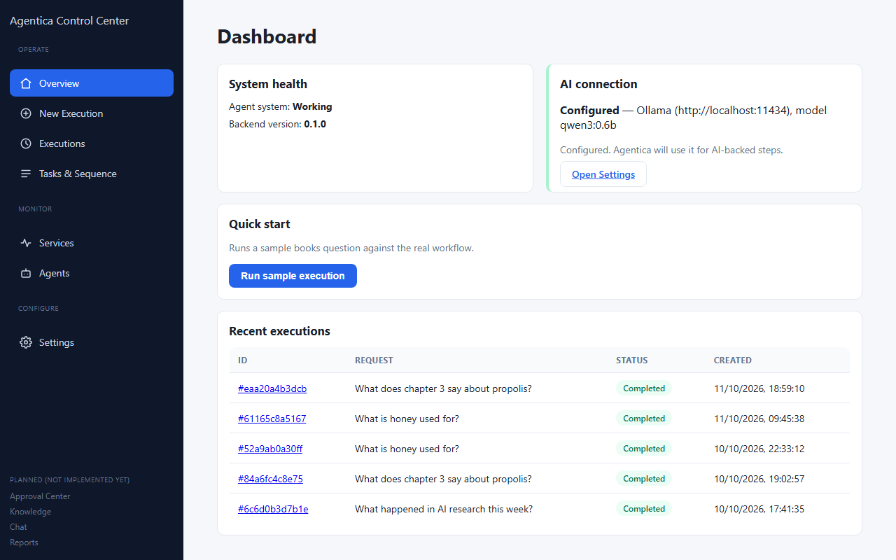
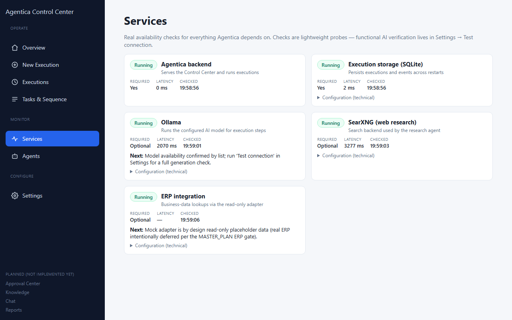
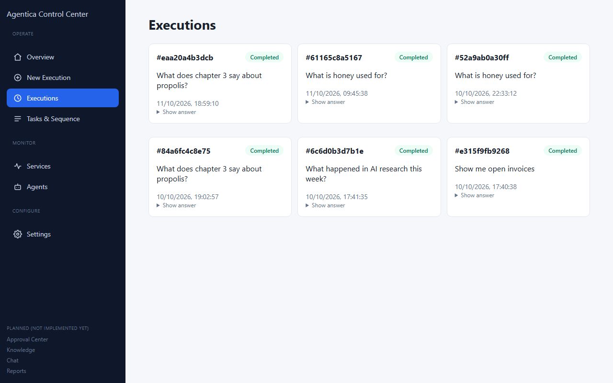

# Agentica

Agentica is a multi-agent assistant for business questions. You type a
question in plain language — "What does our manual say about X?", "What
happened in this market?", "Do a feasibility study for Y", "Show me open
invoices" — and Agentica routes it to the right specialist agent and answers
with sources, provenance, and an honest refusal when it doesn't know.

**Agentica is not finished software.** It is a working development preview:
the agent core (Phases 1–7) and a local web dashboard (the Control Center) are
implemented; larger planned parts (approval workflows, full knowledge
management, chat surface, reports UI) are not started yet — see
[Project status](#project-status-and-support). Everything below describes
what actually works today.

## What Agentica does

From the Control Center you can run an **execution**: a question that goes
through a real, recorded pipeline — supervisor routing → specialist
agents → quality assurance → answer — with every step logged so you can
inspect exactly what ran, what answered, and what it used.

| Agent | What it answers with |
|---|---|
| **books** | Answers from documents you put in the app's library, with file-and-page references, and an exact refusal when the answer isn't there |
| **research** | Web search (SearXNG) → page extraction (Crawl4AI) → LLM synthesis with source URLs |
| **feasibility** | Chains research + books into a Market / Financial / Risk study saved as a `.docx`; clearly flags web-only studies when the library has nothing relevant |
| **erp** | Read-only lookups against a pluggable ERP adapter — today only a built-in mock with fictional data |

The Control Center shows the dashboard (system health + AI connection),
executions history with expandable answers, task sequencing per run, live
service health probes, and AI provider settings.

## What you need

* **Windows** and a Terminal (PowerShell or Command Prompt). All commands
  below use Windows syntax. Setup was tested on Windows only.
* **Python 3.11** — from [python.org](https://www.python.org/downloads/).
  Check the "Use in scripts" option so `py` works.
* **Node.js LTS + npm** — for the dashboard frontend, from
  [nodejs.org](https://nodejs.org/). Check with `npm --version`.
* **Ollama** — runs the AI model locally, from
  [ollama.com](https://ollama.com/). Agentica uses `nomic-embed-text` for
  document search, and (if you pick Ollama as chat provider) a small model
  like `qwen3:0.6b`.
* **Docker Desktop** — only if you want the **research** agent's web search.
  It runs a local SearXNG container. Everything else works without it.
* A free **Google Gemini API key** from
  [Google AI Studio](https://aistudio.google.com/) — only if you choose
  Gemini as the AI provider. Ollama needs no key and no account.

## Installation

Open a terminal in the project root:

```bat
:: 1. Get the code
git clone https://github.com/Juussticee/Agentica.git
cd Agentica

:: 2. Create a Python virtual environment
py -3.11 -m venv env

:: 3. Activate it (needed whenever you work with the project)
env\Scripts\activate

:: 4. Install Python dependencies
python -m pip install -r requirements.txt

:: 5. Install the frontend dependencies (one-time)
cd frontend
npm install
cd ..
```

Then prepare your AI engine. If you picked Ollama (recommended — no API key
needed):

```bat
ollama pull nomic-embed-text
ollama pull qwen3:0.6b
```

`qwen3:0.6b` is very small and runs on CPU. Bigger models (7B+) answer better
but need much more RAM/VRAM.

If you picked Gemini, just make sure you have your API key — you'll save it
below. Note Agentica's **default provider is Gemini** — if you don't set up
Gemini, configure Ollama as shown in the next section.

Optional — only for the research agent's searches:

```bat
docker run -d --name searxng -p 8888:8080 searxng/searxng
```

## Configure Agentica

All settings live in a `.env` file you create at the project root. **Never
commit this file** — it's already git-ignored.

```bat
copy .env.example .env
notepad .env
```

For **Ollama** (no key), make the file contain:

```ini
LLM_PROVIDER=ollama
OLLAMA_BASE_URL=http://localhost:11434
MAIN_MODEL=qwen3:0.6b
```

For **Gemini**, instead set:

```ini
LLM_PROVIDER=gemini
GOOGLE_API_KEY=your_real_key_here
GEMINI_MODEL=gemini-3-flash-preview
```

Save and close Notepad. You can change provider at any time later, either by
editing this file or inside the dashboard on the **Settings** page.

Other optional settings (all commented in `.env.example`): `SEARXNG_URL`,
`ROUTING_MODE`, `PLANNER_MODE`, `MAX_PLAN_TASKS`, `ERP_ADAPTER`.

## Start Agentica

Two terminals — one for the backend, one for the dashboard.

**Terminal 1 — backend API:**

```bat
env\Scripts\python.exe -m uvicorn app.api.server:app --host 127.0.0.1 --port 8000
```

**Terminal 2 — dashboard frontend (no Python needed for this step):**

```bat
cd frontend
npm run dev
```

When both are running, open **http://localhost:3000** in your browser.

The backend serves its API on `http://127.0.0.1:8000` (dashboard calls it
through the `8000` port by default); the dashboard on `3000`. Leave both
terminals open while you use Agentica.

## First run

1. On the dashboard, check **AI connection** shows a green **Configured**
   badge with your provider and model. If not, open **Settings**, pick your
   provider, fill the fields, and press **Test connection** — each check
   step (endpoint reachable, credentials valid, model present, generation
   works) is shown with pass/fail so a problem is easy to locate.
2. Press **Run sample execution** (Quick start). This runs a real sample
   question through the whole pipeline and takes a few seconds — the first
   request is slower while the model loads.
3. Browse: **Executions** shows every past run with expandable answers,
   **Tasks & Sequence** shows the stages a specific execution went through,
   **Services** shows the real health of the backend, storage, Ollama,
   SearXNG, and the ERP adapter.
4. To ask your own question, use **New Execution** at the top of the
   sidebar.

**Stopping** Agentica: press `Ctrl+C` in each of the two terminals. Nothing
else needs closing. **Restarting** later:

```bat
env\Scripts\activate
env\Scripts\python.exe -m uvicorn app.api.server:app --host 127.0.0.1 --port 8000
```
…plus, in another terminal, `cd frontend && npm run dev`.

## Screenshots

*Control Center — Overview (dashboard), service health, and execution
history:*





## Troubleshooting

| Problem | What to do |
|---|---|
| Port 8000 already in use | Start the backend with `--port 8001`. Note the dashboard expects the backend on 8000 by default, so prefer freeing 8000 or editing the port in `frontend/vite.config.ts` |
| Ollama not responding / connection refused | Start Ollama (run `ollama serve` in a third terminal or start the Ollama desktop app), then retry. Check `ollama list` shows both models |
| "Model not found" in Settings → Test connection | `ollama pull qwen3:0.6b` (or the model name you set in MAIN_MODEL) |
| Gemini key invalid / quota errors | Paste a fresh key in **Settings** → Test connection shows per-step diagnostics. The Gemini free tier has low daily limits — repeated multi-agent testing uses it up quickly |
| Dashboard shows "Backend cannot be reached" | Terminal 1 (backend) isn't running, or exited. Check its output; restart if it shows a crash message |
| `npm` is not recognized | Install Node.js LTS from nodejs.org and reopen the terminal |
| First request is slow | The model loads into memory the first time; seconds later runs are faster |
| Want to reset all execution history | Stop the backend, delete `storage\control_center.sqlite3`, start the backend again — the database is recreated automatically |

The exact error in the Settings connection test points at what's wrong —
each phase (configuration, endpoint, reachability, authorization, model
presence, generation) is checked and reported separately.

## Project status and support

This is a **development preview** of an in-progress system, not a
production release. Reference documentation lives in [`docs/`](docs/):

* [docs/PROJECT_STATUS.md](docs/PROJECT_STATUS.md) — what's complete
  (Phases 1–7: routing, books, research, feasibility, ERP boundary,
  production QA node, opt-in LLM routing, planner) and what is not. Phase 8
  **task execution** is pending: plans today are validated and stored, but
  tasks are **not executed** yet.
* [docs/MASTER_PLAN.md](docs/MASTER_PLAN.md) — the authoritative roadmap.
* [docs/CONTROL_CENTER_PLAN.md](docs/CONTROL_CENTER_PLAN.md) — the
  dashboard's features, done and planned.
* [docs/TESTING.md](docs/TESTING.md) — how the test suites run.

Sidebar entries marked "Planned (not implemented yet)" — Approval Center,
Knowledge, Chat, Reports — are honest placeholders, not hidden features.

For questions, bug reports, or contributions, open an issue at
[github.com/Juussticee/Agentica](https://github.com/Juussticee/Agentica).
Code contributions should read the architecture rules in
[docs/ARCHITECTURE.md](docs/ARCHITECTURE.md) and the testing guide before
changing anything — Agentica's design decisions are deliberately
conservative and worth preserving.
