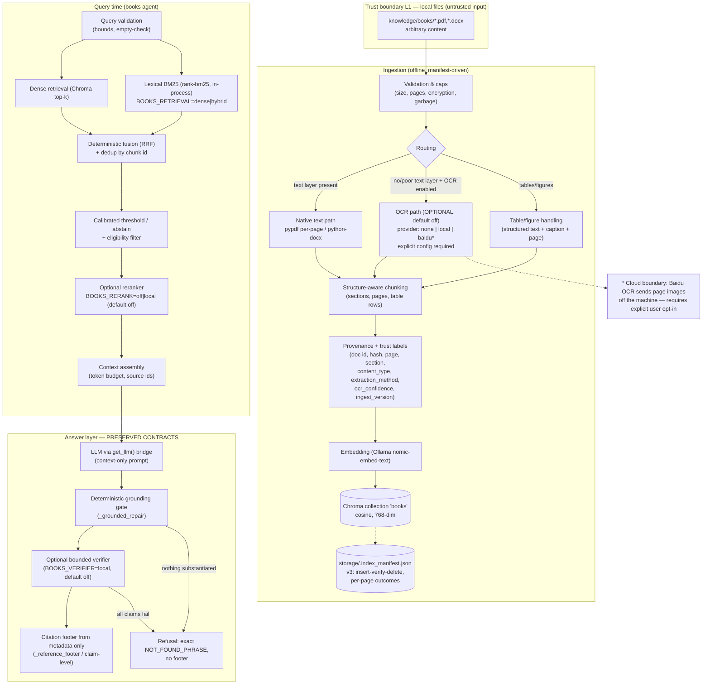

# RAG Optimization — Audit and Implementation Specification

Status: **specification only — nothing in this document is implemented.**
Audited against: branch `main`, HEAD `7a44a9a7f747…` (working tree clean at
inspection time; the four audited workstream commits `4f33734` M2, `fd0f347`
M3–M4C, `38ee18f` GUI-12, `7a44a9a` docs are committed and unpushed).

How to use this document:

> "Implement phase RAG-N from `docs/RAG_IMPLEMENTATION_PLAN.md`."

…must be enough for a coding agent to start without redesigning anything.
Every proposed change carries an acceptance gate; every decision is labelled
**(Evidence)** [supported by inspected source/tests/measurements],
**(Provisional)** [recommended default, not yet validated], or
**(User-policy)** [requires the user's explicit approval]. If an
implementation would contradict a **(User-policy)** decision, a "must never be
added" item (§11.7), or a phase stop-condition (§19), it must stop and report
instead of proceeding.

---

## 1. Executive summary and design principles

Agentica's RAG today is a small, honest, vector-only pipeline over a
2-document corpus: `pypdf`/`docx2txt` extraction → LlamaIndex
`SentenceSplitter` (1024-token chunks) → Ollama `nomic-embed-text` (768-dim,
cosine, Chroma) → top-3 retrieval → single LLM synthesis with a strict
"answer only from context" prompt → a deterministic token/metadata grounding
gate → a model-author-free `References:` footer → an optional bounded
verifier (`BOOKS_VERIFIER=local`, default off). The answer-integrity layer
(M3/M4B/M4C, 106 tests + a 38-case benchmark) is the strongest part of the
system and must not be weakened.

The gaps are almost entirely on the **document-understanding and
measurement** side, not the answer-safety side:

- Extraction is layout-blind: no column reading order, no headings, no
  tables, no figures; DOCX loses all structure (one flat text blob).
- Scanned/image-only pages are reported honestly (`partial`/`failed` in the
  M2 manifest) but never read — there is no OCR path at all.
- Chunking is an unconfigured library default (1024/200 **tokens**), never
  evaluated.
- Retrieval is dense-only with a fixed `top_k=3`, and the `0.35` score floor
  is uncalibrated (measured: the score is `exp(-cosine_distance)`, so 0.35
  ≈ cosine −0.05 — a floor that almost never binds).
- There is **no retrieval evaluation at all**: no gold set, no harness, no
  baseline metrics. Every improvement below is gated on building one first
  (RAG-1), because with a 2×44 KB corpus retrieval quality is currently
  unmeasurable and mostly unmeasured-by-construction.

Design principles used throughout (per the optimization-discipline rules):

1. **Smallest architecture that measurably helps.** Chroma, LlamaIndex,
   Ollama embeddings, the single `get_llm()` factory, the M2 manifest
   integrity model, and the M3/M4B/M4C answer contracts are retained; every
   new component must name the defect it fixes and the experiment that
   justifies keeping it.
2. **Measure before changing.** No chunk size, threshold, retriever, model,
   or reranker changes without a recorded RAG-1/RAG-N comparison.
3. **Provenance end to end.** Every piece of indexed text keeps document,
   page, extraction-method, and version identity; citations are rebuilt only
   from that metadata (never from model text) — the existing contract.
4. **Untrusted document text never gains authority.** Documents are data;
   they cannot alter instructions, thresholds, tool permissions, or the
   citation pipeline. Cloud OCR (if ever enabled) is an explicit, disclosed
   boundary — never a silent upload.
5. **Defaults stay byte-identical.** Every new switch ships default-off /
   current-behavior; the 157-test RAG subset re-run for this audit (exit 0)
   and the recorded 383-test regression are the floor for every phase.

---

## 2. Repository baseline and current RAG architecture

### 2.1 Repository state (confirmed with read-only Git + probes)

| Item | Value |
|---|---|
| Branch / HEAD | `main` @ `7a44a9a7f747…` (docs commit); working tree clean, 0 staged, 0 untracked at baseline |
| Tracked files | 120 |
| Corpus | `knowledge/books/` — exactly 2 files, 44 KB total: `orbital_kinetics_principles.docx`, `urban_beekeeping_field_guide.pdf` (`knowledge/company/` does not exist on disk) |
| Vector store | `storage/chroma.sqlite3`, collection `books`, `{'hnsw:space': 'cosine'}`, **2 persisted chunks** (1 per file), embeddings **768-dim, L2-norm 1.0** (read-only probe of stored vectors) |
| Manifest | `storage/.index_manifest.json`, schema v2, 2 entries, both `indexed`; `scripts/check_chroma.py` re-run for this audit: exit 0, "collection healthy and manifest consistent" |
| Config surface | `.env` contains only `GEMINI_API_KEY`, `LLM_PROVIDER`, `MAIN_MODEL` (variable **names** only were read; no values were accessed). **No Baidu credential exists anywhere in configuration** |
| venv (untracked) | Python 3.11 in `env/`; installed: llama-index 0.14.25, llama-index-core 0.14.25, llama-index-readers-file 0.7.0, llama-index-embeddings-ollama 0.10.0, llama-index-vector-stores-chroma 0.6.0, chromadb 1.5.9, pypdf 6.19.0, docx2txt 0.9, python-docx 1.2.0, langgraph 1.2.12, langchain 1.4.3, **rank-bm25 0.2.2 (installed but NOT declared in `requirements.txt`)**, tiktoken 0.14.0 |
| Not installed | pymupdf, pdfplumber, camelot, docling, pytesseract/easyocr/paddleocr, any Baidu SDK, sentence-transformers, fastembed, llama-index-retrievers-bm25 |
| Ollama (live, read-only `/api/tags`) | `nomic-embed-text:latest` (embedding), `qwen3:0.6b` (completion/tools), **`moondream:latest` (1B, vision-capable — relevant to Q12; quality on charts unmeasured)** |
| Hardware budget | Windows, GTX 1660 Super, **4 GB VRAM** (`docs/Plan.md:4`, mirrored in `docs/MASTER_PLAN.md:44`) |
| Re-run suites (this audit) | `test_ingest_integrity + test_books_grounding + test_citation_integrity + test_verifier + test_m4c_attribution` → **157 passed, 20 subtests, exit 0** (49 s); `benchmark_verification.py --check` → exit 0, 38/38 baseline MATCH + 38/38 integrated MATCH, claim-level mapping 6/6 |

### 2.2 As-is pipeline audit (17 steps)

| # | Step | Actual implementation (source) | Strengths | Limitations / failure behavior | Test coverage | Confirmed by |
|---|---|---|---|---|---|---|
| 1 | Discovery / eligibility | `ingest_books.py::discover_files` (L157): recursive `rglob` for `.pdf`/`.docx`; other files printed as ignored | Unsupported files never silently invisible | No eligibility/trust metadata; every file on disk is eligible by location alone | `test_ingest_integrity` (ignored files) | Code + tests |
| 2 | Validation / caps | `process_file` (L281): `stat()` size cap `INGEST_MAX_FILE_MB=50`; `_pdf_preflight` (L193) checks encryption + page count `INGEST_MAX_PAGES=500` **before decoding**; `_garbage_reason` (L232) binary-garbage guard | Caps enforced pre-decode; encrypted PDFs fail explicitly; clear categories | Caps are crash guards only (corpus is 44 KB); no content-hash, no zip-bomb/xxe consideration for DOCX (docx2txt walks XML) | `test_ingest_integrity` (oversized/page-limit/encrypted/garbage) | Code + tests |
| 3 | PDF/DOCX extraction | `SimpleDirectoryReader` default map: `.pdf` → `PDFReader` (pypdf, **one Document per page**, metadata `page_label`+`file_name`, plain `extract_text()`); `.docx` → `DocxReader` (**docx2txt → ONE Document for the whole file**, no pages) | Page-granular PDF provenance for free; corrupt file → honest `failed` | No layout/column/heading/table semantics at all; docx2txt flattens tables; M2 catches reader-silently-skipping (measured defect that motivated M2) | `test_ingest_integrity` (corrupt/zero-text/mixed) | Installed reader source (`llama_index/readers/file/docs/base.py` L28–L127) + tests |
| 4 | Scanned pages / images / tables / layout | **None.** Unextractable pages are reported by page label in the manifest (`empty_pages`) and the file becomes `partial` | Honest reporting, never "assumed blank" | No OCR path ("this build has no OCR" in `ingest_books.py` docstring/config comment); tables/figures only survive as raw text order | `test_ingest_integrity` (`assertIn("no OCR", …)`) | Code + tests |
| 5 | Normalization | Whatever the readers return; only a garbage check, no unicode/ligature/diacritic normalization | Minimal, monotone | No normalization decisions exist to preserve or break | Indirect | Code |
| 6 | Chunking | `ingest_books.py` L361 `Settings.text_splitter.get_nodes_from_documents(...)` → library-default `SentenceSplitter`: **chunk_size=1024 tokens, overlap=200 tokens**, separator " ", paragraph separator "\n\n\n" (tiktoken cl100k_base tokenizer via `get_tokenizer()`). PDF chunks never cross pages (per-page Documents); DOCX chunks cut anywhere | Simple, sentence-aware, deterministic | Unit is **tokens, not chars** (confirmed in installed source: `constants.py DEFAULT_CHUNK_SIZE = 1024 # tokens`); no heading/section/table awareness; never evaluated | None specific | Installed source + code |
| 7 | Metadata / provenance | LlamaIndex nodes carry `file_name`, `file_path` (absolute), `file_type`, `file_size`, `creation_date`, `last_modified_date`, `doc_id`, `ref_doc_id`, and `page_label` (PDF only); node ids are fresh UUIDs per ingest | Page+file citation provenance is real and validated at answer time | Absolute path sits in stored metadata (filtered from the **LLM context** by `_LocalPathFilter`, `books_agent.py` L614, but stored in Chroma — see §11); DOCX has no page/section provenance; node ids are not stable across re-ingest | `test_verifier` G1 test (context privacy), `test_m4c` privacy tests | Code + stored-metadata probe + tests |
| 8 | Embedding | Ollama `nomic-embed-text` (`app/config.py:59`) via `OllamaEmbedding`; **768-dim, unit-norm** (measured on stored vectors) | Local, fast, free, deterministic per model | Single English-centric model; no model/version recorded in collection metadata; embedding failure = exception at query time (see step 11) | Indirect (MockEmbedding in ingest tests) | Code + probe |
| 9 | Chroma storage / replacement | `_build_index` (L587): `PersistentClient` + `get_or_create_collection(cosine)`; `process_file`: **insert → verify persisted ids → delete stale ids**; partial-write rollback; failed re-process keeps previous vectors + `previous` record; idempotent skip when `mtime_ns` and chunk count match | Strong integrity model (M2); crash-safe per-file manifest saves; legacy v1 verified, not trusted | Collection metadata records only the distance space (no embedding-model/version); deleted files on disk are reported, never pruned (stale-by-deletion possible) | `test_ingest_integrity` (27 tests: replacement/rollback/idempotency/legacy/corrupt manifest) | Code + tests |
| 10 | Query processing | `books_agent()` (L781): raw question straight to `index.as_query_engine()` — **no query validation, rewriting, or normalization** | Deterministic; no extra LLM calls | No handling for empty/oversized/adversarial queries; no filters | None | Code |
| 11 | Candidate retrieval | `similarity_top_k=BOOKS_TOP_K=3` (`config.py:117`); LlamaIndex vector retriever → Chroma cosine top-3; embedding call via Ollama | Small, bounded | Dense-only (exact terms/IDs fail); top_k fixed; **no try/except around the query call (L785): an Ollama/Chroma failure raises out of the node**, and `main.py` `--once`/interactive catch only `GoogleRateLimitError` (L108/L128) → raw traceback to the user | "missing index" path verified by reading only (documented as such in `docs/TESTING.md` §E) | Code |
| 12 | Score filtering / ranking | `low_confidence = score < BOOKS_MIN_SCORE` on the **top-1** node only (`books_agent.py:795`, `config.py:116`); score = `exp(-cosine_distance)` (installed `llama-index-vector-stores-chroma` base.py L472) | Cheap hard floor | **0.35 ≈ cosine −0.05**: the floor almost never binds (nomic scores a tight band ≈0.5–0.8 in this space); no ranking beyond cosine; scores are not calibrated probabilities (code comment at L793 acknowledges the narrow band) | Score-floor refusal path tested with faked scores | Installed source + code |
| 13 | Context assembly | Default `COMPACT` response synthesizer packs all top-3 nodes into one prompt; QA prompt (L658) embeds context + citation-relevant metadata; `_LocalPathFilter` strips non-allowlisted metadata from the LLM context | Path privacy enforced at the query seam; metadata intentionally visible so citations are evidence-backed | No explicit token budget; no dedup/irrelevance removal; context size = whatever 3 chunks cost | `test_verifier` G1 (actual LLM context inspected) | Code + tests |
| 14 | Answer generation | `_GetLlmBridge` (CustomLLM) forwards flat prompts to the single `get_llm()` factory; temperature 0.2; prompt mandates context-only answers + exact not-found phrase | No second model factory; provider-agnostic | Prompt-level instruction is not a security boundary (correctly backstopped by step 15) | `probe_books_prompt` (live), architecture tests | Code |
| 15 | Citation validation / footer | `_strip_model_citations` (L122) removes model-emitted References blocks; `_grounded_repair` (L461) validates inline filename/page/figure claims against retrieved metadata/passage text; `_reference_footer` (L378) rebuilds the footer from validated node metadata of supporting nodes only; missing metadata → explicit "attribution unavailable" | Model can never author a citation; fabricated attribution dropped + disclosed; refusals never cite | Documented residual: cross-passage token splicing not detectable deterministically | `test_citation_integrity` (22+4 subtests), `test_books_grounding` (24+4) | Code + tests |
| 16 | Optional verification | `app/verifier.py` + `_verify_claims` (L718): bounded, monotone, fail-closed; strict JSON contract; per-claim evidence ids whitelisted; 6 claims / 2000 chars / 10 s per claim / 30 s total / 0 retries / 6-permit in-flight budget; M4C claim-level attribution footer | Best-in-class bounded verifier design; off by default (byte-identical M3) | Real-model entailment quality unmeasured (optional `eval_verifier_local.py` shows **latency**, not accuracy, is binding: 17–26 of 31 calls exceeded the 10 s bound) | `test_verifier` (49+12), `test_m4c_attribution` (35), `benchmark_verification` (38 cases, both drift gates green) | Code + tests + benchmark |
| 17 | Refusal / failure handling | Refusal = prompt phrase + sentence-level `_refusal_only` (L66) + score floor + grounding refusal + (when enabled) verifier fail-closed abstention; mandated phrase `NOT_FOUND_PHRASE` (`config.py:118`): **"The requested information was not found in the books."**; refusals carry no footer | Deterministic, disclosed, tested from every angle | Retrieval-subsystem crash is not fail-soft at the agent boundary (step 11); partial-index honesty exists at ingest time but the query path cannot tell the user "this document is partially indexed" | All of the above suites; live refusal via `test_phase1_e2e`/`verify_graph` (quota) | Code + tests |

### 2.3 What is deliberately NOT present (verified absent, not assumed)

No OCR, no layout parser, no table extractor, no BM25/lexical path (the
`rank-bm25` package happens to be installed but is unused and undeclared), no
reranker, no retrieval evaluation harness (`scripts/test_rag1_evaluation.py`
from `docs/MASTER_PLAN.md` §5.1 was never written), no access control of any
kind, no query rewriting for books, no index-version recording, no
observability beyond `print()` lines.

---

## 3. Confirmed facts vs assumptions and unknowns

**Confirmed (code, installed source, or probes this audit ran):** everything
in §2, including: chunk unit = tokens (1024/200 defaults); score =
`exp(-cosine_distance)`; embedding dim 768 + unit norm; per-page PDF
documents; one-document DOCX; insert-verify-delete replacement; exact
fallback phrase (`config.py:118`); verifier bounds and default-off mode;
157-test RAG subset green + benchmark gates green (re-run, exit 0); no Baidu
configuration anywhere; `rank-bm25` installed but undeclared; `main.py`
non-quota exception handling gaps.

**Documented-but-unverified (tests don't cover it; do not treat as proven):**

- The empty/missing-index refusal path (`docs/TESTING.md` §E says "verified
  by reading").
- Any claim about live retrieval quality on the real corpus (no harness
  exists).
- Real-model entailment quality of the verifier (`eval_verifier_local.py`
  measures latency only; not re-run here because it is a model call).

**Assumptions rejected during this audit (corrected in this document):**

- "BOOKS_MIN_SCORE=0.35 is a meaningful similarity floor" — it is a floor in
  an exponential score space; effective cosine floor ≈ −0.05.
- "RAG-5 (grounding/citation validation) from MASTER_PLAN §5.1 is future
  work" — it is largely **delivered** by M3/M4B/M4C; the phase IDs are
  remapped in §14 with justification.

**Unknowns (must be resolved by measurement or the user):**

| Unknown | Why it matters | Resolved by |
|---|---|---|
| Which Baidu OCR product/API the user's key actually covers | No Baidu config exists in the repo; product capability determines tables/layout/limits (§7.5) | **User** + provider docs before RAG-5 Baidu path |
| Whether documents may be uploaded to Baidu at all | Privacy boundary: content leaves the machine | **User** (blocks RAG-5 Baidu path; local OCR unaffected) |
| Required languages (English only vs Arabic too) | nomic-embed-text is English-centric; Arabic corpus changes the embedding decision (§9.3) | **User**; measured in RAG-1 if Arabic cases exist |
| Corpus growth plan (2 tiny files today) | Retrieval/chunking metrics are unmeasurable at 2×44 KB; gold-set categories (tables, scans, multi-column) have no real examples | **User**; RAG-1 records the gap honestly |
| Whether the exact refusal phrase is a strict compatibility contract | It is asserted by tests today; changing it would break live tests | **User** (default: treat as frozen) |
| Whether charts/images need visual interpretation | Decides whether any vision path ever exists (none is proposed for first release) | **User** (deferred; text/caption only) |

---

## 4. Current bottlenecks and optimization hypotheses

Each hypothesis names the measurement that would confirm or reject it. None
is an implementation instruction.

| ID | Hypothesis | Evidence today | Confirmed/rejected by |
|---|---|---|---|
| H1 | Layout-blind extraction corrupts reading order on multi-column / table pages, producing chunks that mix unrelated content | pypdf `extract_text()` has no column logic (pypdf docs: PDFs have no semantic layer); reader source shows plain extraction | RAG-2 fixture comparison (labeled pages, human review) |
| H2 | DOCX ingestion loses headings/structure; section context is unavailable for chunking and citation | `DocxReader` = docx2txt → single flat Document (reader source) | RAG-2 DOCX structure tests |
| H3 | The 1024-token default chunk is not optimal for this corpus/task (too coarse for precise citation, or too fine for context) | Library default, never configured or evaluated | RAG-1/RAG-2 chunk sweep on the gold set |
| H4 | Dense-only retrieval misses exact identifiers (part numbers, invoice IDs, names) | MASTER_PLAN §4.1 states it; unmeasured on this corpus | RAG-1 exact-term subset → RAG-3 hybrid A/B |
| H5 | The 0.35 floor neither helps nor reliably triggers; refusal correctness leans on prompt + grounding | Score-space math (§2.2 step 12); code comment at `books_agent.py:793` | RAG-1 score-distribution collection + calibration |
| H6 | Fixed `top_k=3` under-retrieves once the corpus grows and over-retrieves noise once a reranker exists | 2 chunks exist today; trivially satisfied | RAG-3 candidate-count sweep |
| H7 | Scanned pages are permanently invisible content | No OCR; manifest names the pages honestly | RAG-5 (only if corpus actually contains scans — see §18 Q6) |
| H8 | No baseline = no verifiable improvement for any of the above | No harness exists | RAG-1 (its deliverable) |
| H9 | Retrieval failures are not fail-soft: Ollama/Chroma outage raises out of the agent; `--once` shows a traceback | `books_agent.py:785` (no try/except); `main.py:108/128` (quota-only catches) | RAG-6 hardening (or earlier if the user wants it in RAG-2) |
| H10 | The corpus is too small for any retrieval metric to discriminate (top-3 over 2 chunks retrieves everything) | 2 chunks measured | RAG-1 must build a **separate eval collection** (see §13.4) |

---

## 5. Target architecture (with trust boundaries)

Kept deliberately close to today's topology: same graph, same agent
contract, same store, one new seam (`app/retrieval/`) and one new optional
provider family (`app/ocr/`), both behind default-off switches.



Trust boundaries: **L1** untrusted files → **L2** deterministic processing
(validation, extraction, OCR, chunking, provenance — no LLM, no authority);
**L3** retrieval/answer (LLM sees only filtered evidence; model output can
only lose content, never gain authority); **L4** optional cloud boundary
(OCR images out — user-gated). No document-derived content may ever trigger
tools, code execution, threshold changes, or eligibility changes.

---

## 6. Component responsibilities and data contracts

| Component | Responsibility | Input → Output | New / modified / reused | Dependencies (why) | Error/timeout behavior | Required tests | First release? |
|---|---|---|---|---|---|---|---|
| `ingest_books.py` (kept) | Discovery, caps, routing, per-file integrity | files → manifest entries + vectors | Modified minimally (routing hook, v3 manifest fields) | existing | Existing M2 categories + one new category per §7.6 | Extend `test_ingest_integrity` | Yes |
| `app/ingest/extractors.py` (new, RAG-2) | Structure-aware text extraction per format | path → `ExtractedDoc{pages:[{page_label, text, blocks}], sections, tables, method}` | New | pypdf/python-docx (installed); optional approved parser | Per-file try/except → M2 category; never raises out | Fake-reader unit tests | Yes |
| `app/ingest/chunking.py` (new, RAG-2) | Chunk creation with boundaries + provenance | `ExtractedDoc` → chunk records (stable ids) | New | tiktoken tokenizer (installed) | Deterministic; empty-chunk filtered | Boundary/metadata unit tests | Yes |
| `app/retrieval/store.py` (new, RAG-3) | Dense retrieval seam (wraps current Chroma access) | query + filters → ranked chunks | New (extracts existing code path) | chromadb, Ollama embed | Bounded; failure classified `unavailable` | Fake-collection tests | Yes |
| `app/retrieval/lexical.py` (new, RAG-3) | In-process BM25 over manifest-verified chunks | query → ranked chunk ids | New | `rank-bm25` (already installed; declare it) | Rebuild-on-change; empty index → no contribution | Exact-token hit tests | Yes (switch default off) |
| `app/retrieval/fusion.py` (new, RAG-3) | RRF fusion + dedup | two ranked lists → fused list | New | none (pure function) | Deterministic | Order math unit tests | Yes (with switch) |
| `app/retrieval/rerank.py` (new, RAG-4, conditional) | Optional reranker | candidates → reordered | New (only if justified) | sentence-transformers/cross-encoder (heavy) | Timeout → fall back to unfused order, disclosed | Off-path byte-identity tests | **Conditional** |
| `app/ocr/base.py` (new, RAG-5) | Provider-neutral OCR interface | page image → `{text, confidence, provider, model}` | New | none | Classified errors; fail → manifest category, never fake text | Fake-provider tests | Interface yes; providers conditional |
| `app/ocr/providers/{none,local,baidu}.py` (new, RAG-5) | Concrete OCR providers | page image → same contract | New | local: tesseract/rapidocr (if approved); baidu: requests (installed) | Rate/size/timeout bounds per §7.5 | Offline fake-HTTP tests for baidu | Local optional; Baidu **user-gated** |
| `app/agents/books_agent.py` (kept) | Answer + citations + refusal (contract frozen) | state → answer | Modified only at the retrieval seam (`_get_query_engine` → retrieval layer) | existing | Fail-soft retrieval failure added in RAG-6 (H9) | All existing 157 RAG tests must stay green | Yes (unchanged behavior) |
| `app/verifier.py` (kept) | Bounded claim verification | claims+evidence → verdicts | Unchanged | existing | existing | Existing 49 tests | Yes (unchanged) |
| Gold set + harness (`benchmarks/rag_gold_v1.json`, `scripts/eval_retrieval.py`, RAG-1) | Measurement | gold cases → metrics report | New | none (offline embeddings only via local Ollama — labeled integration) | Never mutates the real collection | Deterministic harness tests | Yes (first) |

Data contract for a chunk record (the stable evidence unit — §8.3):

```text
chunk_id        : "<file_sha256[:16]>:<section_or_page>:<index>"   (deterministic)
document_id     : file path relative to knowledge/books (NEVER absolute)
file_sha256     : content hash of the source file
page(s)         : int page number(s)  | null (docx: section-based)
section_path    : ["Chapter 2", "Ventilation"] | null
content_type    : prose | heading | table | caption | ocr | list
text            : the chunk text (verbatim from extraction)
extraction      : {method: pypdf|docx2txt|python-docx|ocr, provider?, model?, confidence?}
trust_label     : "local-source" (future: per-document trust)
ingest_version  : integer, bumped when extraction/chunking changes
eligible        : boolean (driven by manifest status: indexed/partial→true, failed→false)
```

Metadata actually stored in Chroma stays LlamaIndex-compatible (the node
serializer is internal); the extra fields ride in node metadata and are
added to `_LocalPathFilter`'s **exclusion** list unless citation-relevant
(`content_type`, `section_path` are LLM-visible; `file_sha256`,
`ingest_version`, `confidence` are not).

---

## 7. Document parsing and OCR strategy

### 7.1 Primary path (retain)

- **PDF:** pypdf per-page extraction stays the baseline (it already gives
  page-granular provenance and the M2 integrity model is built around it).
  **(Evidence)** Its known limits are accepted as the *baseline*, not as the
  target: no column reading order, no tables, no headings.
- **DOCX:** docx2txt stays until RAG-2 replaces it with **python-docx**
  structure-aware extraction (already installed, MIT) producing
  heading-paragraph-table blocks → section paths for chunks and citations.
  **(Provisional → validated in RAG-2)**

### 7.2 Candidate additions (benchmark-first, none adopted yet)

| Candidate | License | What it would fix | Local cost | Verdict |
|---|---|---|---|---|
| python-docx structure | MIT, installed | H2 (DOCX headings/sections/tables) | negligible | **Adopt in RAG-2** if fixture tests show structure fidelity (expected) |
| PyMuPDF / PyMuPDF4LLM | **AGPL or commercial** | H1 (columns, tables, reading order) | CPU-only, fast | **Benchmark first** — blocked on license approval (user-policy) |
| pdfplumber | MIT | table geometry extraction for table pages | CPU, memory-heavy on big PDFs | Benchmark first (table pages only, not whole docs) |
| Camelot 2.x | MIT | ruled-table extraction | adds stack; table-only | **Reject for now** (overlaps pdfplumber; single-writer principle) |
| Docling | MIT code (model licenses separate) | headings + tables + layout in one model pipeline | model downloads; CPU-viable but heavy vs today's 2-doc scale | **Defer** — revisit only if pypdf+python-docx path fails RAG-2 acceptance on real layout fixtures |
| Marker | Apache code / OpenRAIL weights | model-driven blocks | heavy inference stack | **Reject for now** (weight-license + resource friction) |

### 7.3 Routing policy (RAG-5, measurable rules — not undocumented heuristics)

Per page, after native extraction compute:

- `chars` = non-whitespace characters; `alpha_ratio` = letters/chars;
- `replacement_ratio` = U+FFFD/chars (mojibake indicator).

Route decision (thresholds to be **calibrated in RAG-5 on labeled fixture
pages**, initial values provisional):

1. Native text is used when `chars ≥ 200` AND `alpha_ratio ≥ 0.5` AND
   `replacement_ratio ≤ 0.02` (initial values — **(Provisional)**).
2. Otherwise the page is an **OCR candidate**; if OCR is disabled the page is
   reported exactly as today ("no extractable text", never "blank") and the
   file becomes `partial` — honest, unchanged behavior.
3. If OCR is enabled, the page is OCR'd; the OCR text **replaces nothing** —
   it becomes an additional chunk stream with `content_type=ocr`,
   provider/model/confidence recorded, page provenance preserved.
4. A file where every page took the OCR route and OCR failed → `failed`
   (category `ocr_failed`); partial OCR success → `partial` listing the
   failed pages. The manifest never claims full coverage it does not have.

### 7.4 Preserving originals

Original extracted text is always kept alongside any OCR/table rendering;
transformations are additive. Citations resolve to the source document and
page regardless of which path produced the text.

### 7.5 Baidu OCR (optional, provider-isolated, user-gated)

Facts confirmed from Baidu's documentation (no API was called):

- Sync endpoints: `general_basic` / `general` / `accurate_basic` /
  `accurate` (text lines; the "含位置" variants add coordinates).
  **Generic OCR does NOT return table structure, layout, or captions** —
  table extraction is the separate **Table OCR V2** (`/ocr/v1/table`) and
  document analysis products (`doc_analysis_office`, async 文档解析 which
  accepts multi-page PDF up to 2000 pages via URL).
- Auth: API Key + Secret Key → OAuth `client_credentials` access_token
  (30-day expiry). **No credential values were read or are reproduced here;
  the repo currently contains no Baidu configuration at all.**
- Limits: general_basic ≈ 8 MB base64, min side 15 px, max side 4096 px;
  accurate variants ≈ 10 MB / 8192 px; sync PDF input selects ONE page per
  call (`pdf_file_num`). Free quota ≈ 1 000 calls/month (individual),
  2 QPS unpaid / 10 QPS paid.
- Sources: `cloud.baidu.com/doc/OCR/` overview, calling-method (auth),
  general-scene pricing/quotas, `general_basic`/`table` specs, 文档解析
  spec.

Required interface behavior (all mandatory, tested offline with fake
responses; **unresolved until the user names the product their key
covers**):

1. `BOOKS_OCR_PROVIDER = none | local | baidu` — default `none`; Baidu is
   inert without explicit config **and** explicit consent flag.
2. Allowlisted operations only: `general_basic` (page text), `table` (table
   pages), nothing else. No document-analysis/async upload path in the
   first release.
3. Request bounds: render page images at 200–300 DPI, resize so the longest
   side ≤ 4096 px and payload ≤ 4 MB; one page per request.
4. Timeouts: connect 5 s, read 30 s; ≤ 2 retries on transient 5xx only;
   rate limiter ≤ 1 QPS (under the 2 QPS unpaid cap); concurrency ≤ 2;
   per-file page budget ≤ `INGEST_MAX_PAGES`.
5. Error classification: `auth` (bad token → hard stop, message names the
   env var, never the key), `rate_limited` (backoff once, then fail the
   page), `payload_too_large` (resize once, then fail the page),
   `provider_error`, `timeout` → per-page manifest category.
6. Provenance: every OCR chunk records provider, endpoint, API version,
   and confidence if returned; page number preserved.
7. Secrets: credentials only in `.env` (git-ignored) or a future
   `Sites: Secrets`-style store; **never** in logs, prompts, fixtures, or
   exception messages; access_token never logged.
8. Privacy boundary (must be printed at ingest start whenever Baidu is
   enabled): *"OCR enabled with provider 'baidu': page images are sent to
  Baidu's cloud API. Document content will leave this machine."*
9. Offline tests: a fake HTTP layer drives every error class and the happy
   path; no test may touch the network.
10. Failure state: OCR unavailable ⇒ pages reported exactly as today;
    ingestion never blocks on OCR being down, and never fabricates text.

**Local-first default:** RAG-5 ships the local provider first (Tesseract 5
Apache-2.0, `ara` traineddata available — relevant if Arabic arrives;
RapidOCR/ONNX as the higher-quality CPU alternative to benchmark). Baidu is
an optional accelerator behind the same interface, blocked on user approval.

---

## 8. Chunking and provenance strategy

### 8.1 Current (baseline to beat)

`SentenceSplitter` 1024 tokens / 200 overlap, applied **per Document**:
PDF pages split independently (chunks never cross pages — good for
citation, bad for paragraphs split at page ends); DOCX splits one flat blob
(no structure at all). Unit confirmed as **tokens** (tiktoken cl100k_base).
Both corpus files are smaller than one chunk today, which is exactly why
chunking is untested in production.

### 8.2 Candidates to evaluate (RAG-2, all measured against RAG-1)

| ID | Strategy | Rationale |
|---|---|---|
| C0 | Current 1024/200 | Baseline, must be re-measured |
| C1 | Smaller fixed (512/64) | Finer citation granularity, more chunks |
| C2 | Larger fixed (1536/128) | More context per chunk |
| C3 | Heading/section-aware (DOCX via python-docx styles; PDF via bold/caps/font-size heuristics **only if** an approved parser provides them) | Sections are the natural evidence unit for manuals/guides |
| C4 | Page-bound + sentence pack (pack whole sentences up to N tokens within one page; never cross pages for PDF) | Preserves today's page-citation property while fixing sentence breaks |
| C5 | Table chunks as structured Markdown rows with a caption header, `content_type=table` | Tables must not be flattened into prose soup |
| C6 | Parent/child (retrieve child, cite/report parent) | Only if C3–C5 show context starvation — **deferred** |

Rules for boundaries (apply to every candidate): never split inside a
numbered procedure step; keep a heading with the first paragraph it governs;
never split a table row; repeated table headers are stored once per chunk
with `content_type=table`, not duplicated prose; captions attach to their
figure/table chunk; footnotes/references stay in their section; OCR chunks
are page-bounded like PDF chunks; cross-page/cross-section context is a
retrieval-time concern (expansion), not a chunk-time merge.

### 8.3 Stable ids and re-ingestion

- `chunk_id = f"{file_sha256[:16]}:{page_or_section}:{index}"` — stable
  across re-ingests of identical content; changes when content changes
  (correct behavior: new content = new evidence).
- Node ids in Chroma can stay LlamaIndex UUIDs (the store's internal key);
  `chunk_id` is carried as metadata for dedup, fusion, and citation
  stability. Re-ingest semantics are **unchanged**: insert → verify →
  delete stale (per `file_path` + now also per `file_sha256`); failed
  replacement keeps the previous version; missing files are reported, not
  pruned (unchanged).
- Manifest gains (schema v3, backward-readable v2): `file_sha256`,
  `ingest_version`, per-page `extraction_method`, `ocr` outcomes, and
  `eligible`. The M2 status model (`indexed`/`partial`/`failed`) is
  **reused, not replaced**: "quarantine" is simply `failed` + ineligible;
  `partial` stays retrievable with its disclosed gaps.

### 8.4 Citations

Citations resolve `chunk_id → (document, page/section)` from stored
metadata only. The existing `_source_ref` validation is extended (not
replaced): page labels keep the current display guard; new fields
(`section_path`, `content_type`) render as `file, "Section", page N`.
The footer formats (answer-level and claim-level) are frozen by tests.

---

## 9. Embedding and index strategy

### 9.1 Baseline (keep until measured otherwise)

`nomic-embed-text` via Ollama: **768-dim, unit-norm (measured), cosine
space** (collection metadata `hnsw:space=cosine`); query and documents use
the same model (compatible by construction). Chroma config, HNSW defaults,
and LlamaIndex's `exp(-distance)` score conversion are all retained.

### 9.2 What RAG-1 must record about embeddings

Score distribution (min/median/max) for answerable vs unanswerable queries;
per-query latency of the Ollama embed call; failure behavior when Ollama is
down. This is the data behind H5/H6 and the only justification basis for
ever changing the model.

### 9.3 Replacement policy (do not replace for novelty)

- Replacement is considered **only** if RAG-1 shows misses attributable to
  the embedding (semantic near-misses that BM25 cannot close), or if the
  corpus becomes multilingual (**Arabic ⇒ nomic is a poor fit; a
  multilingual model such as multilingual-e5-small becomes the candidate —
  CPU-friendly, ~2 GB class, (Provisional)**).
- Any replacement requires: model + dimension + license review; a
  **new collection name** (`books_<model>_<ingest_version>`), full re-index
  from the manifest, side-by-side evaluation on the gold set, config-switch
  swap, and the old collection retained for rollback. **Never** re-embed in
  place inside the existing collection.
- Index/model versioning: record `embedding_model`, `ingest_version`, and
  collection name in the manifest run summary (not per chunk — avoid
  redundant metadata).
- Partial embedding failure handling already exists (per-file rollback) and
  is preserved.
- Caching: none proposed. Ollama already caches loaded models; per-chunk
  embedding caching adds a store to invalidate for zero measured benefit at
  this scale — **rejected (architecture bloat)**.

---

## 10. Retrieval, hybrid search, reranking, and context assembly

### 10.1 Target retrieval flow (RAG-3)

1. Validate query: non-empty, length-capped (e.g. 2 000 chars → truncate +
   disclose), no PII-shaped logging.
2. Apply eligibility filter (only chunks from manifest `indexed`/`partial`
   files; `failed`/quarantined never retrieved).
3. Dense retrieval: Chroma top-k (k swept over {3, 5, 8}).
4. If `BOOKS_RETRIEVAL=hybrid`: lexical retrieval in-process — BM25 over
   the manifest-verified chunk texts (chunk strings are already in node
   metadata; no second copy of the corpus is needed), rebuilt when the
   manifest version changes.
5. Fusion: **reciprocal rank fusion** (RRF, k=60) — deterministic, needs no
   score calibration between two incomparable score spaces. (Chroma scores
   are `exp(-distance)`; BM25 is unbounded — fusing raw scores is rejected.)
6. Dedup by `chunk_id`; drop chunks whose fused rank is below the
   calibrated floor.
7. Optional reranker (`BOOKS_RERANK=off|local`, **default off**) — see §10.3.
8. Context assembly: explicit token budget (default = current implicit
   behavior, measured in RAG-1; then capped), ordered by fused rank, each
   block prefixed with its source id + page/section.
9. Answer generation → existing grounding gate → existing citation/refusal
   contracts, unchanged.

### 10.2 Threshold calibration (replaces the uncalibrated 0.35)

RAG-1 collects score distributions for gold answerable and gold
unanswerable queries on the frozen baseline. RAG-3 proposes an operating
point (target: keep today's refusal-correctness while improving
answerable recall), reports the precision/recall trade-off, and **asks the
user to approve the number** — thresholds are not invented silently. The
score is never presented to users as a probability.

### 10.3 Reranking — conditional, cost-gated

Adopt only if RAG-3 fusion leaves measurable evidence-ranking failures that
a reranker fixes on the gold set. Constraints if adopted: ≤ 50 candidates,
one small cross-encoder (CPU-first; must fit 4 GB VRAM shared with nothing
else, or run on CPU), 2 s wall-clock budget, timeout → transparent fallback
to fused order with a logged reason, and the citation/refusal contracts
untouched. Expected retention bar: a pre-registered improvement on
nDCG@5 / gold-evidence coverage agreed with the user. Otherwise: **defer
forever** (documented as rejected-by-measurement).

### 10.4 Explicit non-goals for retrieval

No query decomposition / multi-hop / iterative retrieval (MASTER_PLAN RAG-6
"only if needed" — remains unneeded until simpler stages measurably fail);
no new vector database; no external search service; no query expansion
until RAG-1 shows it helps.

---

## 11. Security and trust-boundary model

### 11.1 Risk analysis (current exposure)

| Risk | Current state | Plan |
|---|---|---|
| Prompt injection in documents | Mitigated: `_INJECTION_CUES` drop (narrow, monotone), grounding gate drops unsupported content, verifier prompt fences untrusted evidence, model-authored citation blocks stripped. Residual: paraphrased injection without cues survives only if its tokens are in-context (documented limitation) | Keep; add adversarial corpus cases in RAG-1/RAG-6 |
| Malicious instructions in scans/images | N/A today (no OCR) | OCR text inherits exactly the same untrusted status — no new authority |
| Document poisoning / misleading evidence | Grounding + polarity gates remove contradicted claims; conflicts disclosed | Unchanged; add cross-document conflict cases to gold set |
| Fake citations | Model can never author a footer; inline filename/page/figure claims validated against retrieved metadata | Unchanged |
| Cross-user leakage | Single-user local app; no ACL exists | Security contract specified (§11.4); actual ACL deferred until multi-user is a real requirement — **user-policy** |
| Metadata / document-ID manipulation | `chunk_id` derived from content hash; ids validated against per-claim whitelists | Content-hash ids strengthen this in RAG-2 |
| Unauthorized retrieval via crafted queries | No authorization layer (none needed for single-user) | Contract only; fail-closed when introduced |
| Stale index entries | Insert-verify-delete per file; missing files reported, not pruned | Add explicit "file deleted on disk" ineligibility (small RAG-2 item) |
| Cloud OCR exposure | OCR absent | User-gated; privacy banner; no silent upload (§7.5) |
| Secrets | `.env` git-ignored; no keys in code/tests/fixtures (verified) | Keep; Baidu keys follow the same rule |
| Resource exhaustion | Size/page caps pre-decode; garbage guard | Add per-file OCR page budget, per-request payload caps, DOCX entry-count sanity (RAG-5/6) |
| Stale/partial data after failures | M2 model is honest and tested | Preserve; never weaken |
| Unsafe tool use from retrieved text | Books agent has **no tools** by construction; document text cannot escalate anything | Keep books agent tool-free (§11.7) |
| Answers mixing incompatible versions | One file version at a time (stale deleted after insert-verify); `file_sha256` in chunks makes version mixing detectable | RAG-2 |

### 11.2 Layered defenses (to preserve/extend)

Validation limits → provenance/trust labels → eligibility filtering →
retrieval-time authorization hook (no-op today) → untrusted-evidence
separation in prompts → deterministic grounding gate → bounded optional
verifier → metadata-only citations → fail-closed abstention. Prompt wording
is never the only defense; no stage may *add* content.

### 11.3 The four separations (kept explicit)

1. **Source-document trust** (where it came from) — ingest-time label.
2. **Retrievability** (may it be retrieved at all) — manifest
   `eligible`, fail-closed.
3. **Evidential support** (does a passage support a claim) — grounding
   gate + verifier.
4. **Action authority** (may an answer trigger anything) — books answers
   never trigger tools; feasibility/ERP keep their own boundaries.

### 11.4 Required security contract for a future multi-user build (not implemented now)

Every retrieval must filter by the caller's document ACL **before** candidate
content is materialized; ACL checks fail closed; personalized responses are
no-store; document ids are never accepted from the client. If/when
authorization is required, it must be specified as a phase of its own —
this plan does not invent an identity system.

### 11.5 Adversarial regression tests (RAG-6 deliverable)

Injected-instruction documents (PDF + DOCX + OCR text), fake citation
strings inside documents, conflicting duplicate documents, oversized/
malformed/encrypted files, page-flood OCR attempts, cross-document ID
collisions, and stale-version questions — all as clearly labeled fixture
documents in the **eval collection**, never in the real corpus.

### 11.6 Fail-closed rules

Authorization failure, integrity failure, verifier uncertainty, citation
unresolvability, OCR uncertainty → remove/discard/disclose, never bless.
No new failure may resolve to "answer anyway".

### 11.7 What must never be added (RAG hard constraints)

- No tool invocation, code execution, or side effect driven by document or
  OCR content.
- No second LLM factory; everything goes through `get_llm()` (MASTER_PLAN
  §3.1).
- No silent cloud calls of any kind (OCR included).
- No model-authored citations; no footer on refusals.
- No in-place re-embedding/replacement of an existing collection without a
  written migration+rollback step.
- No benchmark that rewrites its own expected answers/evidence mappings.
- No new orchestration framework/vector DB/search service without a
  decision-register entry approved by the user.

---

## 12. Citation, verification, and abstention compatibility

**Frozen contracts (byte-identical unless the user approves a change):**

- Refusal phrase: `"The requested information was not found in the books."`
  (`app/config.py:118` — confirmed from source; asserted by
  `test_phase1_e2e`/`test_phase1_proxy` and grounding tests).
  *Note: `docs/PROJECT_STATUS.md:50` still quotes the older Phase-1
  wording "That information was not found in your books." — code wins; the
  doc discrepancy is recorded here and must not be "fixed" by silently
  changing the phrase.*
- Deterministic grounding gate (`_grounded_repair`), sentence-level refusal
  detection, citation stripping, injection cues, polarity gates.
- Citation footers built only from validated metadata of supporting nodes;
  "attribution unavailable" markers; no footer on refusals.
- Verifier default `off` = byte-identical M3; verifier bounds (6/2000/10/30/
  0-retries/6-permit); monotone removal-only; fixed disclosure strings.
- Claim-level attribution footer format (M4C).

**Scenario matrix (behavior the plan must preserve or define):**

| Situation | Required behavior |
|---|---|
| No evidence retrieved | Exact refusal phrase, no footer (existing) |
| Evidence retrieved but nothing substantiated | Grounding refusal, exact phrase, no score note (existing) |
| OCR fails for some pages | File `partial`, failed pages named in manifest; answer may use what exists — never claim the missing pages |
| Document partially indexed | Same as today: honest manifest + retrievable content; (RAG-2 adds nothing new here) |
| Evidence conflicts | Polarity gate / verifier `contradicted` → claim removed + fixed conflict note (existing) |
| Citations cannot resolve (missing metadata) | Explicit "attribution unavailable", never an invented name (existing) |
| Verifier disabled/unavailable/busy | `off` → M3 behavior; unavailable → claim removed + fixed note; all-unavailable → refusal + "(semantic verification unavailable)" (existing) |
| Retrieval subsystem times out / errors | **Gap (H9)**: currently raises out; RAG-6 defines fail-soft → fixed "books retrieval unavailable" message, provenance honest, no fallback to guessing |
| Source changed since indexing | Re-ingest replaces per-file atomically; old version's vectors removed only after the new ones verify (existing M2) |

Retrieval relevance is never equated with entailment anywhere in this plan.

---

## 13. Gold dataset and evaluation protocol

### 13.1 What RAG-1 measures first

The **existing** pipeline, frozen: dense top-3, 1024-token chunks, current
prompt/gate/verifier-off. Every later phase compares against this record.

### 13.2 Case schema (`benchmarks/rag_gold_v1.json`)

```json
{
  "id": "G007",
  "query": "...",
  "answerable": true,
  "gold_documents": ["urban_beekeeping_field_guide.pdf"],
  "gold_pages": [3],
  "gold_chunks_hint": "section 'Varroa treatment' paragraph 2",
  "required_facts": ["exact expected values/phrases"],
  "citation_expectation": "file+page | file-only | refusal",
  "labels": ["exact-term", "table", "ocr", "multi-doc", "adversarial-injection", "unanswerable", ...],
  "provenance": "hand-written by <reviewer>, date, reviewed-by"
}
```

Target 40–60 cases **if the corpus supports it**. With today's 2×44 KB
corpus it will not: the honest first cut is (a) every real question the
sample corpus can answer, (b) labeled *unanswerable* cases (easy to review),
(c) exact-term cases, and (d) an explicit **gap list** of categories the
corpus cannot exercise (tables, scans, multi-column, multi-page tables,
figures, cross-document). Fabricated evidence for missing categories is
**not** created unless the user approves clearly-labeled synthetic fixtures
(§18 Q9).

### 13.3 Metrics

Retrieval (automatic): Recall@k (k=1,3,5), Precision@k, MRR, nDCG@k,
gold-evidence coverage, latency percentiles, failure/timeout counts.
Answer (mixed): citation correctness (automatic vs gold metadata),
unsupported-claim rate (grounding-gate drop rate), correct-abstention and
false-abstention rates (automatic against `answerable`), answer correctness
against `required_facts` (automatic subset + human review), OCR/extraction
completeness for visual cases (human). Latency and resource use recorded
per run.

### 13.4 Repeatability rules

- The gold set is versioned, human-reviewed, and **immutable to the
  code under test** — a benchmark may never rewrite its own expected
  answers or evidence mappings (hard rule, §11.7).
- Evaluation runs against a **separate eval collection**
  (`books_eval_<hash>`) built in a temp dir from fixture documents; the
  real corpus/index is never touched. Integration smoke tests may query the
  real index read-only.
- Each run records: run id, git HEAD, config snapshot (top_k, chunk
  params, model names/versions, switch states), and machine notes.
- Deterministic components are asserted deterministic; LLM-dependent
  metrics are labeled as such and never gate a phase on a single run.

### 13.5 Regression gates

Proposed (numbers need user approval — not invented silently):

- No gold-set retrieval metric may drop vs the recorded baseline beyond an
  agreed margin (initial proposal: any drop is a failure until reviewed).
- Refusal correctness (both directions) must not drop at all.
- Existing suites stay green: RAG subset (157 tests, re-run today, exit 0),
  full 383-test regression, `benchmark_verification.py --check` (exit 0,
  re-run today).
- Every phase ships its own new deterministic suite (zero quota, offline).

---

## 14. Phased implementation roadmap

Phase IDs follow the task's sequence (RAG-1…RAG-6). This **differs from
`docs/MASTER_PLAN.md` §5.1** (where RAG-2=hybrid, RAG-3=fusion/rerank,
RAG-4=metadata, RAG-5=grounding, RAG-6=multi-hop). Justification: MASTER_PLAN's
RAG-5 (grounding/citation validation) was already delivered by M3/M4B/M4C
(106 tests + 38-case benchmark), its RAG-4 (metadata) is largely satisfied
by page/file provenance, and extraction/OCR were never scheduled at all
even though they are the measured weaknesses (H1/H2/H7). The old IDs are
mapped, not silently dropped: old RAG-2/3 → new RAG-3/4; old RAG-4 → new
RAG-2 (metadata comes from parsing); old RAG-5 → done (M3/M4B/M4C); old
RAG-6 → still deferred ("only if needed", unchanged).

**Fourth-track clarification (2026-10-17 reconciliation).** End-to-end
**answer-quality evaluation is NOT any of the RAG-2s** — during the RAG-1
closeout it was called "RAG-2 (answer quality)", a third meaning on top of
the two above. Both roadmaps now register it as **RAG-AE**, defined once in
`docs/MASTER_PLAN.md` §5.1 (problem/scope/dependencies/tests/acceptance) and
deliberately placed **outside the numbered RAG-1…RAG-6 implementation
sequence** of this table, so no row here is renumbered, removed, or
re-scoped. Full mapping as of this date:

| Concept | MASTER_PLAN §5.1 (this plan's "old") | This plan §14 (new) |
|---|---|---|
| Baseline & evaluation | RAG-1 | RAG-1 (delivered) |
| Parsing & structure-aware chunking | RAG-4 (metadata) | RAG-2 |
| Hybrid dense + lexical retrieval | RAG-2 | RAG-3 |
| Fusion / reranking | RAG-3 | RAG-4 |
| OCR / tables / scans | (never scheduled) | RAG-5 |
| Grounding / citation validation | RAG-5 | done by M3/M4B/M4C |
| Multi-hop / decomposition | RAG-6 | deferred (same) |
| Hardening / final regression | (never scheduled) | RAG-6 |
| **Answer-quality evaluation** | **RAG-AE** (new track) | **RAG-AE** (not a row in §14) |

Architecture references were inspected before this reconciliation:
`docs/ARCHITECTURE.md` (no phase IDs), `docs/Plan.md` (no phase IDs), and
`docs/CONTROL_CENTER_PLAN.md` (twice "MASTER_PLAN RAG-1…RAG-6") — all still
accurate, since RAG-AE adds no numbered ID.

| Phase | Goal | Problem addressed | Exact implementation changes | Files/modules likely to change | Dependencies | Tests to add/update | Acceptance criteria | Security implications | Performance/resources | Rollback/migration | Depends on | Out of scope |
|---|---|---|---|---|---|---|---|---|---|---|---|---|
| **RAG-1** Baseline & evaluation | Measure today's pipeline reproducibly | H8, H10 | New gold JSON + `scripts/eval_retrieval.py` (harness: builds temp eval collection with fixture docs + MockEmbedding-compatible seam, runs the real retrieval path, prints metrics + run metadata); baseline report committed as JSON | `benchmarks/rag_gold_v1.json`, `scripts/eval_retrieval.py`, `scripts/test_rag_eval_harness.py`, `docs/TESTING.md` (add row) | none | Deterministic harness tests with fakes (ordering, metrics math, immutability of gold) | Harness runs end-to-end offline; baseline metrics recorded; gold gaps listed; **no production code changed** | Injection fixtures live only in the eval collection | Ollama embed calls only if the user opts into a live run (labeled) | n/a (additive) | none | Changing retrieval/chunking/anything |
| **RAG-2** Parsing & structure-aware chunking | Fix extraction/provenance defects | H1, H2, H3 | `app/ingest/extractors.py` (pypdf pages + python-docx sections/tables); `app/ingest/chunking.py` (C3/C4/C5 candidates behind `BOOKS_CHUNKING=legacy|structure`, default `legacy`); manifest v3 fields (`file_sha256`, `ingest_version`, per-page method, `eligible`); stable `chunk_id`; wire into `ingest_books.py` (routing hook only; M2 integrity untouched); extend `_LocalPathFilter` exclusions | `ingest_books.py`, `app/config.py`, new `app/ingest/*`, `scripts/test_ingest_integrity.py` (+ new `scripts/test_structure_chunking.py`), `scripts/check_chroma.py` | RAG-1 baseline recorded | Extractor/chunker unit tests with fake readers; re-ingest idempotency on the v3 manifest; legacy-v2 manifest migration; all 27 existing ingest tests must stay green (v2 readers still supported) | C3/C4/C5 beat or tie C0 on the gold set (agreed margin); citations still resolve to file+page/section; insert-verify-delete and rollback proven intact | None new; ingest cost may rise slightly (structure parse) | Manifest v3 written compatibly; rollback = set `BOOKS_CHUNKING=legacy` + re-ingest (old chunks replaced by the same integrity path) | RAG-1 | OCR; new parsers beyond python-docx unless approved |
| **RAG-3** Retrieval optimization | Fix dense-only misses; calibrate thresholds | H4, H5, H6 | `app/retrieval/{store,lexical,fusion}.py`; `BOOKS_RETRIEVAL=dense|hybrid` (default `dense`); declare `rank-bm25` in `requirements.txt` (already installed); threshold-calibration report + proposed value for user approval; candidate-count sweep | new `app/retrieval/*`, `app/agents/books_agent.py` (seam only: `_get_query_engine` delegates), `app/config.py`, `requirements.txt`, `scripts/test_hybrid_retrieval.py` | RAG-2 (chunk ids/metadata) | Fusion math unit tests; BM25 exact-token hits on a fake corpus; dense path byte-identical when lexical finds nothing; no-network guarantee | Exact-term subset improves vs baseline; refusal suite unchanged; default config byte-identical to RAG-2 | Eligibility filter applied before candidates materialize | Pure config rollback (`dense`) | RAG-2 | Query expansion, multi-hop |
| **RAG-4** Evidence ranking & context assembly | Only if RAG-3 shows ranking failures | H6 (residual) | Optional `BOOKS_RERANK=off|local`; explicit context token budget; dedup; (deferred) neighbor expansion | `app/retrieval/rerank.py` (+ config/tests) | RAG-3 | Off-path byte-identity; rerank timeout fallback; budget enforcement tests | Pre-registered nDCG/coverage gain agreed with user, within latency budget; else **rejected-by-measurement and removed** | No new authority; reranker sees only already-retrieved evidence | CPU-first model; ≤ 2 s; ≤ 50 candidates | Config off = RAG-3 behavior | RAG-3 | Any second orchestrator; iterative retrieval |
| **RAG-5** OCR, tables, figures, scanned pages | Make scanned/visual documents honest citizens | H7 (+tables) | `app/ocr/base.py` provider interface; providers `none` (default) / `local` (Tesseract, optional) / `baidu` (user-gated); routing rules §7.3; table chunks (C5) with provenance; manifest per-page OCR outcomes; ingest-time privacy banner | new `app/ocr/*`, `ingest_books.py`, `app/config.py`, `scripts/test_ocr_routing.py`, `scripts/test_ocr_providers.py` (offline fakes) | RAG-2 (structure/routing), user decisions Q2/Q6 | Fake-provider suite; routing-threshold tests on labeled fixture pages; privacy-banner test; failure-state tests | Scanned fixture pages index with page provenance and `content_type=ocr`; disabled-OCR behavior byte-identical to today; no test touches the network | Cloud upload only with explicit consent; keys never logged; bounded requests | ≤ 1 QPS, ≤ 2 concurrent, page/DPI caps | `BOOKS_OCR_PROVIDER=none` restores today | RAG-2 (+ Q2/Q6 answers) | Document-analysis/async upload; chart understanding; vision QA |
| **RAG-6** Security, reliability, final regression | Harden and prove | H9 + adversarial gaps | Fail-soft retrieval errors in `books_agent` (fixed message, honest provenance); query bounds; DOCX entry-count sanity; adversarial fixture battery; ops documentation (log fields per §16); full regression run | `app/agents/books_agent.py`, `main.py` (exception parity for `--once`/interactive), `app/config.py`, tests, `docs/TESTING.md` | RAG-1…5 | Adversarial suite; outage simulations (Ollama down → clean message, no traceback); bounded-work assertions | Full 383+ regression green; new adversarial suite green; every failure path produces a disclosed, non-hallucinated outcome | Completes §11 checklist | No new runtime cost | N/A | RAG-3 | Multi-user ACL implementation |

### 14.1 Phase execution rules (bounded tasks)

For each phase the implementing agent must: (1) state preconditions met;
(2) touch only the files listed in its row (new files allowed; a phase may
never edit another phase's tests to make its own pass); (3) run the phase's
tests **and** the frozen regression floor; (4) run the eval harness against
the recorded baseline and paste the comparison; (5) write a short completion
report (changes, metrics delta, deviations, new risks); (6) **stop** at the
phase boundary. Expanding scope, adding a dependency, or changing an
approved default requires returning to the user first.

---

## 15. Dependency decision matrix

| Candidate | Problem solved | License (verified) | Maintenance/compat | Local resources | Expected impact | Complexity cost | Security | Evaluation | Recommendation |
|---|---|---|---|---|---|---|---|---|---|
| pypdf (current) | Baseline PDF text | BSD-3 | active (6.19.0 installed) | CPU, tiny | known layout limits | none (present) | none new | is the baseline | **Keep** as baseline path |
| python-docx | DOCX structure (H2) | MIT, installed | stable (1.2.0) | tiny | high for DOCX | low | none | RAG-2 fixtures | **Adopt (RAG-2)** |
| PyMuPDF4LLM | Columns/tables (H1) | **AGPL/commercial** | active | CPU-only | potentially high on layout docs | medium | license obligation | RAG-2 benchmark **after user license answer** | Benchmark first — blocked on approval |
| pdfplumber | Table geometry | MIT | active | CPU, memory-heavy | medium (table pages) | low-medium | none | RAG-2/RAG-5 table fixtures | Benchmark first |
| Camelot | Ruled tables | MIT | active (2.x) | adds stack | overlaps pdfplumber | unnecessary | none | — | **Reject** (single-writer) |
| Docling | Unified layout model | MIT code (model licenses vary) | active | model downloads; CPU-heavy | uncertain at this scale | high | model-license review | defer to failed RAG-2 acceptance | **Defer** |
| Marker | Model blocks | Apache code / OpenRAIL weights | active | heavy | uncertain | high | weight license | — | **Reject for now** |
| Tesseract 5 | Local OCR baseline | Apache-2.0 | established | tiny (CPU) | unmeasured | low | none | RAG-5 fixtures | **Adopt as first local provider (RAG-5)** |
| RapidOCR (ONNX) | Higher-quality local OCR | Apache-2.0 | active (v3.x) | CPU via onnxruntime | unmeasured | low-medium | none | RAG-5 A/B vs Tesseract | Benchmark first |
| PaddleOCR | OCR + structure | Apache-2.0 | very active | heavier install (PaddlePaddle) | unmeasured | medium | none | only if others fail | Defer |
| Surya | OCR+layout VLM | code Apache / weights OpenRAIL | active | 650M model; Windows friction | unmeasured | high | weight license, heavy | — | **Reject** for this hardware |
| Baidu OCR | Cloud OCR accuracy | proprietary | vendor | network + quota (≈1000 free calls/mo, 2 QPS) | unmeasured | medium (interface already planned) | **data leaves machine** | only with user consent + fake-HTTP tests | **Conditional (user-policy)** |
| rank-bm25 | Exact-term retrieval (H4) | MIT-ish (permissive), installed 0.2.2 | stable, pure Python | negligible | measured in RAG-3 | tiny (but must be declared) | none | RAG-3 A/B | **Adopt (RAG-3)** + declare in requirements |
| RRF fusion | Merging two rankers | n/a (pure function) | n/a | negligible | deterministic | tiny | none | unit tests | **Adopt (RAG-3)** |
| Cross-encoder reranker | Ranking quality | typically Apache weights | active | CPU/4 GB VRAM tight | conditional | medium | none | RAG-4 gate | **Conditional / likely reject** |
| sentence-transformers / fastembed | Embedding candidates | Apache | active | model downloads | only if nomic fails | medium | none | RAG-1/§9.3 policy | **Reject unless embedding eval demands** |
| New vector DB / LangChain / orchestration framework | — | — | — | — | **none measured** | high | new attack surface | — | **Reject** (bloat; violates §11.7) |

---

## 16. Acceptance criteria, observability, and operations

**Phase-level acceptance** lives in §14's table; the global gates are:

1. Frozen regression floor green after every phase: RAG subset (157 tests,
   20 subtests — re-run for this audit, exit 0), the full recorded 383-test
   regression, `benchmark_verification.py --check` (exit 0, re-run for this
   audit), `check_chroma.py` (exit 0).
2. Eval-harness comparison vs the recorded baseline with the agreed metric
   deltas (no silent threshold invention).
3. Byte-identical default behavior: every new switch in its default state
   reproduces the prior phase's answers (asserted by tests).

**Minimum log/diagnostic fields (reuse `print()` conventions; no new
platform):** ingest — document id, outcome, route (native/ocr), pages
processed/failed, chunk count, verification result, duration; retrieval —
method (dense/hybrid), candidate counts, threshold decision, abstention
reason category, stage latencies; eval — run id + config version. Never log
document contents, OCR payloads, absolute paths (relative to
`knowledge/books` only), or credentials. Diagnostic payloads are
aggregate-only and opt-in.

---

## 17. Migration, rollback, and compatibility

- **Manifest v2→v3**: readable upgrade path exactly like the existing v1→v2
  migration (verify, never trust); v3 entries written only by v3 code; a
  v3 rollback leaves a still-valid v2-compatible core (status/chunks).
- **Collection/model changes**: always a *new* collection name + full
  re-index + config switch + retained old collection (§9.3). Never in-place.
- **Config switches**: `BOOKS_CHUNKING`, `BOOKS_RETRIEVAL`, `BOOKS_RERANK`,
  `BOOKS_OCR_PROVIDER` — all in `app/config.py` (single-config rule),
  all default to current behavior, all validated at load like
  `BOOKS_VERIFIER` is today.
- **Answer-layer compatibility**: nothing in RAG-1…6 may change the refusal
  phrase, footer formats, disclosure strings, or verifier defaults; live
  scripts (`verify_graph`, `test_phase1_e2e`) remain the manual
  compatibility check.
- **Dependency changes**: `requirements.txt` is the single declared set;
  the already-installed-but-undeclared `rank-bm25` is reconciled in RAG-3;
  no other new package without a decision-register update.

---

## 18. Risks, unresolved questions, and decisions requiring user approval

| # | Question | Why it matters | Options | Consequences | Recommended default (not approved) | Blocks? |
|---|---|---|---|---|---|---|
| Q1 | Corpus trust: internal trusted material, arbitrary uploads, or both? | Dictates how much adversarial hardening is "required before processing" vs "extra" | trusted internal / arbitrary / both | Arbitrary uploads make §11.5 adversarial fixtures mandatory before RAG-5 | Treat as trusted-internal now; design keeps trust labels so "both" is additive | Blocks RAG-5 scope |
| Q2 | May document pages be sent to Baidu (or any cloud OCR)? | Privacy: content leaves the machine | cloud allowed / local-only / case-by-case | Cloud OCR inert without consent | **local-only** until explicit consent | Blocks Baidu path only |
| Q3 | Which Baidu product does the user's key cover (general/accurate/table/文档解析)? | Capability/limits differ radically (§7.5); repo has no Baidu config today | user states product | Selects allowlisted endpoints | unresolved — must be user-stated | Blocks Baidu path |
| Q4 | Languages: English only, or Arabic too? | nomic + pypdf are English-centric; Arabic changes OCR (Tesseract `ara`) and embedding (multilingual) decisions | EN / EN+AR | EN+AR adds candidate models + eval cases | EN now; EN+AR as an explicit extension | Can decide later; affects §9.3 |
| Q5 | Local resource vs latency priority (4 GB VRAM shared) | Gates reranker/heavy parsers | quality-first / latency-first / balanced | Balanced keeps everything CPU-first | **balanced** | Later |
| Q6 | Will the real corpus actually contain scans/tables/multi-column docs? | RAG-5's value depends entirely on this | yes soon / no / unknown | If no, RAG-5 shrinks to the provider interface + routing honesty | RAG-5 stays conditional on RAG-1's gap list | Shapes RAG-5 scope |
| Q7 | Per-user/per-role document authorization needed now or later? | Introduces ACL filtering at retrieval (fail-closed) | now / later / never | Now = a dedicated phase (not in this roadmap) | **later** (contract in §11.4) | Not blocking |
| Q8 | Is the exact refusal phrase a strict compatibility contract? | Live tests assert it; feasibility web-only detection keys off it | frozen / revisable | Frozen = zero risk | **frozen** | Not blocking |
| Q9 | May RAG-1 use clearly-labeled synthetic fixture documents (in the eval collection only) to cover missing categories? | Tables/scans/columns have no real examples yet | allow / real-only | Synthetic docs must never be cited in production answers | **allow, eval-collection only, labeled** | Blocks complete RAG-1 metrics |
| Q10 | Acceptable evaluation thresholds (§13.5 margins) | Gates every phase | approve proposed / amend | Unapproved numbers cannot be invented | propose at RAG-1 completion | Blocks phase gates |
| Q11 | Is AGPL acceptable (PyMuPDF4LLM) for the parsing path? | License obligation | accept / avoid | Avoid → MIT-only parsing (pdfplumber/python-docx/pypdf) | **avoid for now** | Blocks that candidate only |
| Q12 | Do charts/images require visual interpretation, or are text/captions sufficient? | Decides whether any vision path ever exists; no vision component is proposed for the first release. Note: a local vision-capable model (`moondream`, 1B, Ollama) is already installed, so a local-first option exists without any cloud boundary | text+caption only / visual interpretation required (local moondream candidate) | Visual QA would add a new evidence type and a per-page vision cost against the 4 GB VRAM budget; a separate future phase, not in this roadmap | **text/caption only** for the first release | Not blocking (vision = separate phase if ever) |
| Q13 | Expected corpus growth, and are the 50 MB / 500-page limits still right? | Corpus is 2×44 KB today; limits are crash guards, not tuning knobs | corpus stays small / grows to hundreds of docs | Growth changes top-k and chunking trade-offs and makes RAG-1 metrics meaningful; OCR-era pages may warrant tighter per-file budgets (D-15) | grow the corpus before RAG-2 tuning concludes; keep limits until measurements say otherwise | Not blocking |

## 18.1 Key risks

- **Measurability risk:** with a 2-document corpus, RAG-2/3 improvements may
  be unmeasurable; mitigation is Q9 synthetic fixtures + user-grown corpus.
- **Scope risk:** OCR/tables investment may target documents the corpus never
  grows to contain (Q6) — hence RAG-5's conditional gate.
- **Over-refusal risk:** tighter chunking/thresholds can raise false
  abstentions; refusal-correctness is a non-regressing gate.
- **License risk:** the best layout parser is AGPL (Q11); MIT fallbacks are
  specified.
- **Cloud risk:** any Baidu enablement is a privacy boundary and a quota/
  rate-limit dependency; the plan works fully without it.

---

## 19. Exact implementation order and stop conditions

Order: **RAG-1 → RAG-2 → RAG-3 → (RAG-4 only if gated) → RAG-5 (only if
Q2/Q6 allow) → RAG-6**. Within each phase: tests-first for the new seam,
then implementation, then eval comparison, then regression floor, then
report. RAG-6 may not be skipped regardless of earlier success.

**Stop conditions (any one ⇒ stop and report, do not improvise):**

1. A gate in §13.5 or §14 fails and cannot be fixed within the phase's file
   list.
2. A new dependency, architectural decision, or default change not covered
   by an approved decision-register row appears.
3. The evaluation cannot discriminate (corpus too small, Q9 unanswered).
4. The repository changes underneath (branch/HEAD/tree differ from the
   recorded phase baseline).
5. Any step would require touching the frozen answer-layer contracts
   (§12) or the M2 integrity model.
6. Live/quota-consuming or cloud-touching behavior would be needed without
   explicit user authorization.

## 19.1 Final report format (per phase)

`Phase | files changed | new tests + results | eval delta vs baseline |
regression floor result | deviations from this spec | new risks | next
phase recommendation` — one screen, no self-graded "done" without the
numbers.

---

## 20. References — the actual repository files behind this audit

Core runtime: `ingest_books.py` (discovery L157, preflight L193, garbage
guard L232, per-file pipeline L281, chunking call L361, insert L383, skip
L458, run L477, store build L587); `app/agents/books_agent.py` (refusal
markers L57, refusal detector L66, citation strip L122, footers L378/L409,
grounding gate L461, path filter L609/L614, query engine L640–679, evidence
L685, verifier seam L718, agent L781, query call L785, score floor L795);
`app/verifier.py` (contract docstring L1–100, bounds L118/L124, `_call_llm`
L168, parser L225, evidence bound L274, `verify_all` L327);
`app/config.py` (L44–59 providers/embeddings, L102–118 paths/retrieval,
L126–135 ingest caps, L145–168 verifier bounds); `app/llm_client.py`
(single factory); `app/qa_node.py` (deterministic QA); `main.py` (L66/L73
demo catches; L108/L128 quota-only catches).

Docs: `docs/MASTER_PLAN.md` §4 (option comparison L306–346) and §5.1
(RAG roadmap L351–470 — remapped here with justification); `docs/Plan.md:4`
(hardware); `docs/TESTING.md` (suite inventory, 383-test regression, M4C
explainer); `docs/PROJECT_STATUS.md` (M2/M3/M4 history; stale Phase-1
refusal wording noted in §12); `docs/ARCHITECTURE.md` (topology, agent
contract).

Tests/benchmarks: `scripts/test_ingest_integrity.py` (27),
`scripts/test_books_grounding.py` (24+4), `scripts/test_citation_integrity.py`
(22+4), `scripts/test_verifier.py` (49+12), `scripts/test_m4c_attribution.py`
(35), `scripts/benchmark_verification.py` + `benchmarks/verification_cases.json`
(38 cases), `scripts/eval_verifier_local.py` (optional live experiment),
`scripts/check_chroma.py` (read-only store diagnostics), `scripts/check_books_agent.py`,
`scripts/probe_books_prompt.py` (live, quota).

Installed-source evidence used (read-only, in `env/Lib/site-packages`):
`llama_index/readers/file/docs/base.py` L28–L127 (pypdf per-page / docx2txt
flat); `llama_index/core/constants.py` (`DEFAULT_CHUNK_SIZE = 1024 # tokens`);
`llama_index/core/node_parser/text/sentence.py` (overlap 200, tokenizer
default); `llama_index/vector_stores/chroma/base.py` L472
(`similarity_score = math.exp(-distance)`); `llama_index/core/response_synthesizers/factory.py`
(`response_mode: ResponseMode.COMPACT`).

External sources (researched for this spec, no API called): Baidu OCR
documentation — `cloud.baidu.com/doc/OCR/s/Ek3h7xypm` (overview),
`.../Ck3h7y2ia` (auth/calling method), `.../zk3h7xz52` (general_basic spec),
`.../tk3h7y2aq` (accurate), `.../Al1zvpylt` (Table OCR V2),
`.../9k3h7xuv6` (quotas/pricing), `.../Klxag8wiy` (文档解析 limits);
PyMuPDF `pymupdf.readthedocs.io` (license/capabilities); pdfplumber
`github.com/jsvine/pdfplumber`; Camelot `camelot-py.readthedocs.io`; Docling
`github.com/docling-project/docling`; Marker `github.com/datalab-to/marker`;
pypdf `pypdf.readthedocs.io/en/latest/user/extract-text.html`; python-docx
`python-docx.readthedocs.io`; RapidOCR `github.com/RapidAI/RapidOCR`;
PaddleOCR `github.com/PaddlePaddle/PaddleOCR`; Tesseract
`tesseract-ocr.github.io/tessdoc/`; EasyOCR `github.com/JaidedAI/EasyOCR`;
Surya `github.com/datalab-to/surya`.

---

## 21. Decision register

| ID | Decision | Current | Options | Evidence / trade-offs | Recommended | Validation experiment | Approval? | Phase | Status |
|---|---|---|---|---|---|---|---|---|---|
| D-01 | PDF parsing path | pypdf per-page | keep / PyMuPDF4LLM / Docling / pdfplumber | pypdf lacks layout (H1); PyMuPDF best layout but AGPL; Docling heavy | keep pypdf baseline; benchmark others | RAG-2 fixture comparison | Q11 for AGPL | RAG-2 | provisional |
| D-02 | DOCX parsing | docx2txt flat | keep / python-docx structure | python-docx installed, MIT, gives headings/tables | python-docx | RAG-2 structure tests | no | RAG-2 | provisional |
| D-03 | OCR provider | none | none / tesseract / rapidocr / baidu | scans unmeasured in corpus (Q6); cloud leaves machine (Q2) | none now; local Tesseract first, Baidu user-gated | RAG-5 fixture pages | **yes (Q2/Q3/Q6)** | RAG-5 | blocked |
| D-04 | Cloud-data policy | no cloud content upload | forbid / allow-with-consent | privacy boundary | forbid until consent; banner when on | config + test | **yes (Q2)** | RAG-5 | blocked |
| D-05 | Chunking strategy | 1024/200 tokens default | C0–C6 (§8.2) | unmeasured (H3); structure-aware candidates | evaluate C3/C4/C5 behind `BOOKS_CHUNKING=legacy` default | RAG-1/2 sweep | no | RAG-2 | provisional |
| D-06 | Chunk/evidence record | LlamaIndex defaults + page/file | extend with §6 contract | provenance/dedup/versioning gains; slight metadata bloat | adopt §6 record | RAG-2 unit tests | no | RAG-2 | provisional |
| D-07 | Embeddings | nomic-embed-text, 768, cosine | keep / multilingual / other | no measured miss yet; Arabic unknown (Q4) | keep; revisit only per §9.3 policy | RAG-1 distributions (+ Arabic cases if Q4 says so) | **yes if corpus is Arabic** | RAG-1/3 | provisional |
| D-08 | Hybrid retrieval | dense only | dense / BM25+RRF | exact-term weakness (H4); rank-bm25 already installed | hybrid behind switch, default dense | RAG-3 A/B | no | RAG-3 | provisional |
| D-09 | Reranking | none | off / small cross-encoder | cost/latency vs ranking gains on 4 GB VRAM | off until RAG-4 gate | RAG-4 gate | yes if adopted | RAG-4 | provisional |
| D-10 | Context expansion | none (raw top-3) | none / neighbor / parent-child | needs RAG-1 evidence of context starvation | defer | RAG-4 | no | RAG-4 | deferred |
| D-11 | Document versioning | manifest v2, insert-verify-delete | keep / v3 with hashes | v3 strengthens dedup/staleness without weakening M2 | v3 (additive) | RAG-2 migration tests | no | RAG-2 | provisional |
| D-12 | Access control | none (single user) | none / ACL contract only / full ACL | no identity system exists | contract only (§11.4) | n/a | **yes (Q7)** | later | blocked |
| D-13 | Citation behavior | metadata-only footers, frozen | keep / change | 106 tests + benchmark depend on it | keep byte-identical | regression floor | **yes if changed (Q8)** | all | decided |
| D-14 | Evaluation thresholds | none exist | approve RAG-1 proposals / amend | cannot be invented | propose at RAG-1 | §13.5 | **yes (Q10)** | RAG-1 | blocked |
| D-15 | Resource limits | 50 MB / 500 pages | keep / tighten for OCR era | pre-decode caps are sound | keep + OCR per-page budget | RAG-5 tests | no | RAG-5 | provisional |
| D-16 | Synthetic eval fixtures | none | allow (labeled, eval-only) / real-only | needed for missing categories (Q9) | allow, labeled | RAG-1 authoring | **yes (Q9)** | RAG-1 | blocked |
| D-17 | `rank-bm25` declaration | installed, undeclared | declare in requirements / remove | used by RAG-3; must be declared either way | declare at RAG-3 | `check_dependencies` | no | RAG-3 | provisional |
| D-18 | Retrieval fail-soft (H9) | raises out of agent | fix in RAG-6 / earlier | user-visible tracebacks today | RAG-6 (or RAG-2 if user prefers) | outage tests | no | RAG-6 | provisional |

---

## 22. Approval checkpoint

**Recommended architecture in one sentence:** keep the proven Chroma +
nomic + LlamaIndex + M2-integrity + M3/M4B/M4C answer-safety core exactly
as it is; add (a) a measured evaluation harness, (b) structure-aware
extraction/chunking with content-hash provenance, (c) an opt-in hybrid
dense+BM25 retrieval with a calibrated abstention threshold, and (d) an
optional, isolated, local-first OCR provider family with cloud consent
gated on you — each landing only if its gate metric improves.

**Minimum first-release scope (MVP):** RAG-1 + RAG-2 + RAG-3 (switch-gated)
+ RAG-6 hardening. No reranker, no OCR provider beyond the interface, no
new models.

**Ordered backlog:** 1) RAG-1 harness + gold set (+ Q9 answer) → 2) RAG-2
extractors/chunking/manifest v3 → 3) RAG-3 hybrid + calibration (+ Q10) →
4) RAG-4 only if gated → 5) RAG-5 if Q2/Q6 allow → 6) RAG-6 hardening +
full regression + ops doc.

**User-policy questions blocking implementation:** Q1 corpus trust, Q9
synthetic fixtures (blocks complete RAG-1), Q2 cloud-OCR consent + Q3
Baidu product (block only the Baidu path), Q4 languages (affects embedding
decision), Q10 thresholds (block phase gates). None of these blocks
starting RAG-1 except Q9.

**Provisional choices safe to validate during implementation:** D-01/D-02
(parsing candidates), D-05/D-06 (chunking candidates + record), D-08
(hybrid switch), D-17 (declare rank-bm25), D-18 (fail-soft timing).

**Approval checklist:**

- [ ] Architecture approved or amended (§5, §22 summary)
- [ ] MVP scope approved (RAG-1→3 + 6)
- [ ] Q1 corpus trust answered
- [ ] Q4 languages answered
- [ ] Q9 synthetic fixtures approved/denied
- [ ] Q11 AGPL stance answered (PyMuPDF4LLM candidate)
- [ ] Q2/Q3 cloud OCR consent + Baidu product (may be deferred; keeps RAG-5
      local-only)
- [ ] Q10 threshold-approval process accepted
- [ ] One phase authorized to start (recommended: **RAG-1**)

*This specification implements no RAG changes. No source code, tests,
configuration, dependencies, indexes, manifests, or existing documents were
modified; nothing was staged, committed, or pushed.*
